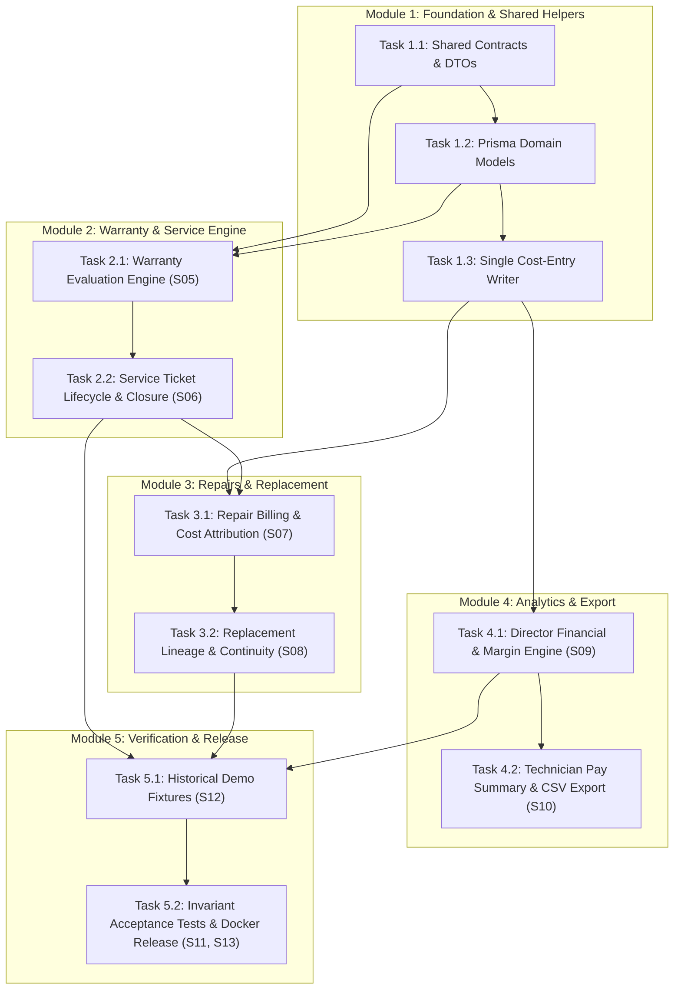

Ran check git remote
Ran fetch from origin
Ran check status and origin/main log
Ran check HEAD log
Ran git pull origin main
Ran check d3/schema-conventions branch
Ran inspect commit 5ecb93f
Ran check open PRs
Ran check if build-backlog.json exists
Ran filter D4 tasks from backlog
Ran inspect first D4 task in backlog
Ran inspect tasks S05-S13
Used MCP tool: auric/log_decision
Used MCP tool: auric/capture_workspace_state

### Git Status & Latest Code Check

`git fetch origin` and `git pull origin main` were executed:
- Local `main` is completely up to date with `origin/main` at commit `c95fb7f` ([PR #3](https://github.com/Muzaffar-codes07/sunshine/pull/3) is merged).
- Tuhin (D3) opened [PR #4](https://github.com/Muzaffar-codes07/sunshine/pull/4) (`feat(db): add schema conventions and required-constraint check`), establishing database schema rules.

---

### D4 Architecture Blueprint

Under the reconciled [TRD](file:///c:/Users/BHANU%20TEJA%20GUPTA%20V/Downloads/Projects/sunshine/docs/TRD.md) and [PRD](file:///c:/Users/BHANU%20TEJA%20GUPTA%20V/Downloads/Projects/sunshine/docs/PRD.md), **D4 owns**:
1. **The Single Cost-Entry Writer** (`apps/api/src/finance/`): The single authority for posting material, installation labor, and repair costs. D3 and D4 both post through this helper.
2. **Warranty Engine & Service Tickets** (`apps/api/src/warranty/`, `service/`): Serial lookup, automated date-boundary warranty evaluation, ₹0 free repairs vs. chargeable billing, and customer-confirmed closure.
3. **Director Reports & Analytics** (`apps/api/src/reporting/`, `subsidy/`): Lifetime job contribution, period-filtered performance, technician pay summary, and formula-injection-safe CSV export.
4. **Cross-Module Integration & Docker Release**: E2E integration harness, demo scenarios, and [`compose.yaml`](file:///c:/Users/BHANU%20TEJA%20GUPTA%20V/Downloads/Projects/sunshine/compose.yaml) release verification.

---

# D4 Modular Task Breakdown

Here are **5 self-contained modules** split into **11 atomic tasks**. Each task is designed with explicit inputs, exact file targets, acceptance tests, and a **copy-paste prompt** you can drop directly into separate AI threads (Codex or Antigravity) without context bleed.



---

## Module 1: Foundation & Shared Helpers

### Task 1.1: Shared Contracts & DTOs
- **Goal:** Define Zod schemas and TypeScript types for all D4 domains in `packages/contracts`.
- **Target Files:**
  - `packages/contracts/src/warranty.ts`
  - `packages/contracts/src/service.ts`
  - `packages/contracts/src/costs.ts`
  - `packages/contracts/src/reports.ts`
  - `packages/contracts/src/index.ts`
- **Implementation Guide:**
  - `warranty.ts`: `WarrantyPolicySchema`, `WarrantyStatusSchema` (`ACTIVE`, `EXPIRED`, `VOID`), `WarrantyAssessmentResultSchema`.
  - `service.ts`: `ServiceTicketStatusSchema` (`OPEN`, `ASSESSED`, `IN_PROGRESS`, `AWAITING_CUSTOMER_CONFIRMATION`, `CLOSED`), `TicketLineSchema`, `CustomerConfirmationSchema`.
  - `costs.ts`: `CostTypeSchema` (`MATERIAL_DISPATCH`, `INSTALLATION_LABOUR`, `SERVICE_LABOUR`, `REPAIR_PARTS`), `CreateCostEntrySchema`.
  - `reports.ts`: `JobProfitabilityReportSchema`, `TechnicianPaySummarySchema`, `SubsidyMilestoneSchema`.
- **Contract alignment:** Use lowerCamelCase schema exports and PascalCase inferred types from `packages/contracts/src/index.ts`. Include `warrantyPolicySchema` (policyName, revision, scope, durationMonths) and `subsidyMilestoneSchema` (id, jobId, stage, status, nullable submissionDate/approvalDate, amount, nullable evidenceFileId). TicketLine includes description and server-derived billableToCustomer. Quantity and totalHours are decimal strings bounded to numeric(12,3). Keep DateRangeFilter as half-open IST calendar dates. See `docs/architecture/api-contracts.md` for the reviewed wire formats.
- **Acceptance:** `npm run build -w @sunshine/contracts` and `npm run test -w @sunshine/contracts` pass cleanly.

> **Copy-Paste Thread Prompt:**
> ```text
> You are working on Task 1.1 for D4 in the Sunshine repo.
> Task: Implement Zod contracts and TypeScript types for Warranty, Service Tickets, Cost Entries, and Reports in packages/contracts/src/.
> 1. Create packages/contracts/src/warranty.ts with WarrantyStatus enum ('ACTIVE', 'EXPIRED', 'VOID'), WarrantyPolicy schema (policyName, revision, scope, durationMonths positive integer), and WarrantyAssessmentResult schema (unitId, serial, policyName, startDate, expiryDate, isCovered, reason, customerCharge).
> 2. Create packages/contracts/src/service.ts with TicketStatus enum ('OPEN', 'ASSESSED', 'IN_PROGRESS', 'AWAITING_CUSTOMER_CONFIRMATION', 'CLOSED'), TicketLine schema (type PART/LABOUR, description, quantity as a positive numeric(12,3) decimal string, unitCost, totalCost, server-derived billableToCustomer), and CustomerConfirmation schema (confirmerName, channel enum ['PHONE', 'WHATSAPP', 'IN_PERSON'], confirmedAt, notes).
> 3. Create packages/contracts/src/costs.ts with CostType enum ('MATERIAL_DISPATCH', 'INSTALLATION_LABOUR', 'SERVICE_LABOUR', 'REPAIR_PARTS') and CreateCostEntryInput schema (uniqueSourceId, jobId, amount decimal string, costType, description).
> 4. Create packages/contracts/src/reports.ts with JobProfitability schema, PaySummary schema (totalHours as a nonnegative numeric(12,3) decimal string), SubsidyMilestone schema (id, jobId, stage, status, nullable submissionDate/approvalDate timestamps, amount decimal string, nullable evidenceFileId), and DateRangeFilter schema (startDate inclusive, endDate exclusive in IST).
> 5. Export everything in packages/contracts/src/index.ts and verify with `npm run build -w @sunshine/contracts`.
> ```

---

### Task 1.2: Prisma Domain Models for D4
- **Goal:** Add D4 data models to `prisma/schema.prisma` conforming to Tuhin's schema conventions.
- **Prerequisite:** Task 1.1
- **Target Files:** `prisma/schema.prisma`
- **Implementation Guide:**
  - Add models: `Warranty`, `ServiceTicket`, `TicketLine`, `CostEntry`, `SubsidyMilestone`.
  - Follow rules in `docs/architecture/schema-conventions.md`: UUID PKs (`@db.Uuid`), explicit relation names, `@map` snake_case table names, money as `Decimal @db.Decimal(14,2)`, UTC timestamps.
  - Add unique constraint on `CostEntry`: `@@unique([uniqueSourceId, costType])` to prevent double counting.
- **Acceptance:** `npx prisma validate` passes.

> **Copy-Paste Thread Prompt:**
> ```text
> You are working on Task 1.2 for D4 in the Sunshine repo.
> Task: Add D4 domain models to prisma/schema.prisma conforming to docs/architecture/schema-conventions.md.
> 1. Add Warranty model (id UUID, unitId UUID unique, startDate DateTime, expiryDate DateTime, policyName String, scope String, active Boolean, createdAt, updatedAt).
> 2. Add CostEntry model (id UUID, uniqueSourceId String, jobId UUID, costType CostType enum, amount Decimal(14,2), description String, postedAt DateTime, createdAt). Ensure @@unique([uniqueSourceId, costType]) to prevent duplicate cost expensing.
> 3. Add ServiceTicket model (id UUID, ticketNumber String unique, customerId UUID, unitId UUID, jobId UUID, status TicketStatus enum, faultDescription String, assessmentSnapshot Json?, confirmedBy String?, confirmationChannel String?, confirmedAt DateTime?, closedAt DateTime?, createdAt, updatedAt).
> 4. Add TicketLine model (id UUID, ticketId UUID, lineType String, description String, quantity Decimal(12,3), unitCost Decimal(14,2), totalCost Decimal(14,2), billableToCustomer Boolean, createdAt).
> 5. Add SubsidyMilestone model (id UUID, jobId UUID, stage String, status String, submissionDate DateTime?, approvalDate DateTime?, amount Decimal(14,2), evidenceFileId UUID?, createdAt, updatedAt).
> 6. Run `npm run db:validate` to ensure schema validity.
> ```

---

### Task 1.3: The Single Cost-Entry Writer (`FinanceService.postCost`)
- **Goal:** Implement the centralized cost-writing service that D3 and D4 use to record all project costs.
- **Prerequisite:** Task 1.1, Task 1.2
- **Target Files:**
  - `apps/api/src/finance/cost-writer.service.ts`
  - `apps/api/src/finance/finance.module.ts`
- **Implementation Guide:**
  - Provide `postCost(tx: PrismaTransaction, input: CreateCostEntryInput): Promise<CostEntry>`.
  - Must accept external `tx` so it commits inside the caller's transaction.
  - Idempotent: checks for existing `uniqueSourceId + costType`; if present, returns existing row without throwing.
- **Acceptance:** Unit test verifying posting twice with the same `uniqueSourceId` does not create duplicate cost rows.

> **Copy-Paste Thread Prompt:**
> ```text
> You are working on Task 1.3 for D4 in the Sunshine repo.
> Task: Build the Single Cost-Entry Writer in apps/api/src/finance/cost-writer.service.ts.
> In TRD decision M2, D4 owns the single cost writer. D3 posts material consumption and installation labour through this function, and D4 posts repair costs through it.
> 1. Implement CostWriterService with method:
>    `async postCost(tx: PrismaClientOrTransaction, input: CreateCostEntryInput): Promise<CostEntry>`
> 2. It must write to prisma.costEntry within the provided tx.
> 3. Handle idempotency: if a record with @@unique([uniqueSourceId, costType]) already exists, return the existing record cleanly without raising duplicate key errors.
> 4. Register CostWriterService in FinanceModule and export it.
> 5. Write a unit test verifying that calling postCost twice with the same source ID and cost type returns the same entry and preserves ledger integrity.
> ```

---

## Module 2: Warranty & Service Engine

### Task 2.1: Warranty Evaluation Engine & Serial Lookup (S05)
- **Implementation status:** Engine, contracts, Prisma warranty reader, Nest route and isolated/HTTP tests implemented. Production lookup remains integration-gated (503): Unit/Job reads, staff authorization and the coordinated D4 migration are absent on this branch. See `apps/api/src/warranty/README.md`. Uncovered lookup charges are null/PENDING_ASSESSMENT until Task 3.1 can price assessed repair work. Canonical route: `/api/v1/warranties/lookup`.
- **Goal:** Build the instant hardware serial lookup and the deterministic warranty decision calculator.
- **Prerequisite:** Task 1.1, Task 1.2
- **Target Files:**
  - `apps/api/src/warranty/warranty.service.ts`
  - `apps/api/src/warranty/warranty.controller.ts`
  - `apps/api/src/warranty/warranty.module.ts`
- **Implementation Guide:**
  - `evaluateWarranty(unitId: string, asOfDate: Date): Promise<WarrantyAssessmentResult>`
  - Boundary rule: `startDate <= asOfDate < expiryDate`.
  - If covered: `isCovered = true`, `customerCharge = "0.00"`, `reason = "Under active manufacturer/installer warranty"`.
  - If expired: `isCovered = false`, `reason = "Warranty expired on <date>"`.
  - Endpoint `GET /api/v1/units/lookup?serial=...`: Returns unit, customer, installation job, and live warranty evaluation.
- **Acceptance:** Unit tests testing active date, expired date, exact expiry boundary, and leap year handling.

> **Copy-Paste Thread Prompt:**
> ```text
> You are working on Task 2.1 (Backlog S05) for D4 in the Sunshine repo.
> Task: Build the Warranty Evaluation Engine and Serial Lookup in apps/api/src/warranty/.
> 1. Implement WarrantyService.evaluateWarranty(unitId, asOfDate):
>    - Fetch the unit's active warranty record.
>    - Evaluate condition: startDate <= asOfDate < expiryDate.
>    - Return structured result matching WarrantyAssessmentResultSchema.
>    - If covered: customerCharge is '0.00' and isCovered is true.
>    - If expired or not found: isCovered is false, customerCharge is calculated based on billable rates, and reason explains expiry date.
> 2. Implement WarrantyController:
>    - `GET /api/v1/warranties/lookup?serial=...`: Finds unit by normalized serial, includes job and customer, and returns warranty assessment.
> 3. Add unit tests in warranty.service.spec.ts testing:
>    - Unit assessed 18 months into 2-year warranty -> covered (₹0).
>    - Unit assessed 26 months into 2-year warranty -> expired.
>    - Boundary check at exact expiry midnight.
> ```

---

### Task 2.2: Service Ticket Lifecycle & Customer Confirmation Gate (S06)
- **Implementation status:** Lifecycle, strict shared contracts, Prisma status/version compare-and-set repository, Nest routes and domain/HTTP tests implemented. Resolution notes/time and complete scoped warranty snapshots persist with transitions; closure requires confirmer, supported channel and ordered timestamp. Production routes remain integration-gated (503) pending verified staff access, Unit/Job reads and D3's coordinated migration. See `apps/api/src/service/README.md` and `docs/reviews/d4-task-2.2-review-prompt.md`. Repair billing/replacement remain Tasks 3.1/3.2.
- **Goal:** Implement the ticket lifecycle state machine with the customer confirmation gate.
- **Prerequisite:** Task 2.1
- **Target Files:**
  - `apps/api/src/service/service.service.ts`
  - `apps/api/src/service/service.controller.ts`
  - `apps/api/src/service/service.module.ts`
- **Implementation Guide:**
  - `POST /api/v1/tickets`: Creates ticket in `OPEN` status with fault description.
  - `POST /api/v1/tickets/:id/assess`: Runs `evaluateWarranty`, snapshots the decision JSON onto the ticket, moves to `ASSESSED`.
  - `POST /api/v1/tickets/:id/resolve`: Records technician resolution details, moves status to `AWAITING_CUSTOMER_CONFIRMATION`.
  - `POST /api/v1/tickets/:id/confirm`: **Strict Gate**: requires `confirmerName`, `channel` (`PHONE`, `WHATSAPP`, `IN_PERSON`), and `confirmedAt`. Only then moves to `CLOSED`.
- **Acceptance:** Attempting to transition from `AWAITING_CUSTOMER_CONFIRMATION` to `CLOSED` without confirmation payload fails with HTTP 400/409.

> **Copy-Paste Thread Prompt:**
> ```text
> You are working on Task 2.2 (Backlog S06) for D4 in the Sunshine repo.
> Task: Build the Service Ticket Lifecycle and Confirmation Gate in apps/api/src/service/.
> 1. Implement ServiceService with methods:
>    - `createTicket(input)`: creates ticket with status OPEN.
>    - `assessTicket(ticketId, asOfDate)`: calls WarrantyService.evaluateWarranty, saves assessmentSnapshot in ticket, transitions status to ASSESSED.
>    - `resolveTicket(ticketId, resolutionDetails)`: records repair work done, transitions to AWAITING_CUSTOMER_CONFIRMATION.
>    - `confirmClosure(ticketId, confirmationInput)`: validates that confirmerName, channel, and confirmedAt are present. Sets closedAt and status CLOSED.
> 2. Create ServiceController with corresponding endpoints:
>    - `POST /api/v1/tickets`
>    - `POST /api/v1/tickets/:id/assess`
>    - `POST /api/v1/tickets/:id/resolve`
>    - `POST /api/v1/tickets/:id/confirm`
> 3. Enforce that closing without confirmer facts throws BadRequestException or ConflictException with standard error envelope.
> ```

---

## Module 3: Repairs & Replacement Orchestration

### Task 3.1: Repair Billing & Cost Attribution (S07)
- **Implementation status:** Transaction-aware billing helper, canonical stock/time source reuse, exact cost/pricing arithmetic, immutable ticket billing replay and invariant tests implemented. Source and D2 invoice adapters deliberately return 503 until persisted upstream integrations land. Include billingSnapshot in the coordinated D4 migration; no public billing route is added. See apps/api/src/service/README.md and docs/reviews/d4-task-3.1-review-prompt.md.
- **Goal:** Ensure repairs correctly affect job profitability without corrupting customer balances.
- **Prerequisite:** Task 1.3, Task 2.2
- **Target Files:**
  - `apps/api/src/service/repair-billing.service.ts`
- **Implementation Guide:**
  - If ticket assessment is **Covered**:
    - Customer is billed **₹0.00**.
    - Internal parts and labor costs are logged against the original installation's `jobId` via `CostWriterService.postCost(tx, ...)`.
  - If ticket assessment is **Expired / Out-of-Scope**:
    - Generates invoice lines for parts and labor.
    - Calls D2 invoice helper `FinanceService.ensureServiceInvoice(tx, ...)` to bill customer.
- **Acceptance:** Invariant test proving covered repairs reduce the original job's gross margin while creating zero outstanding receivable for the customer.

> **Copy-Paste Thread Prompt:**
> ```text
> You are working on Task 3.1 (Backlog S07) for D4 in the Sunshine repo.
> Task: Implement Repair Cost Attribution and Chargeable Invoicing in apps/api/src/service/repair-billing.service.ts.
> Business rule: Covered work charges customer ₹0 but reduces job margin by posting actual internal labor and part costs. Expired work generates an invoice for parts and labor.
> 1. Implement executeRepairBilling(tx, ticketId, repairItems):
>    - Read ticket.assessmentSnapshot to determine coverage.
>    - If covered:
>      - Post parts cost via CostWriterService.postCost(tx, { uniqueSourceId: `ticket-part-${ticketId}`, jobId: ticket.jobId, costType: 'REPAIR_PARTS', amount: partsCost }).
>      - Post labour cost via CostWriterService.postCost(tx, { uniqueSourceId: `ticket-labour-${ticketId}`, jobId: ticket.jobId, costType: 'SERVICE_LABOUR', amount: labourCost }).
>      - Create no customer invoice (customer owes ₹0).
>    - If not covered:
>      - Call D2's invoice helper or create an official service Invoice with parts and labour lines billable to customer.
> 2. Add an automated test verifying that covered repairs post cost entries against the original job ID without generating a customer invoice.
> ```

---

### Task 3.2: Hardware Replacement Lineage & Warranty Continuity (S08)
- **Implementation status:** Transaction-aware replacement helper, D3 stock port, exact original warranty continuation, old/new ticket lineage, immutable replay, same-transaction Task 3.1 billing and invariant tests implemented. Production stock adapter returns 503 pending D3 inventory/source integration, auth and coordinated migration; no public replacement route or placeholder Unit model. Uses ALLOCATED per the primary guide. See apps/api/src/service/README.md and docs/reviews/d4-task-3.2-review-prompt.md.
- **Goal:** Orchestrate unit swap when a defective inverter/battery is replaced, preserving serial lineage and warranty dates.
- **Prerequisite:** Task 3.1
- **Target Files:**
  - `apps/api/src/service/replacement.service.ts`
- **Implementation Guide:**
  - Executes inside a transaction:
    1. Old unit status $\rightarrow$ `QUARANTINE`.
    2. New unit status $\rightarrow$ `ALLOCATED`.
    3. Old serial and new serial are linked on the ticket (`replacedUnitId`, `newUnitId`).
    4. **Warranty Continuity:** The new unit inherits the original warranty's policy and expiry date (it does NOT restart a 2-year or 20-year clock!).
- **Acceptance:** Test verifying replacement maintains old/new unit IDs and retains the original expiry date.

> **Copy-Paste Thread Prompt:**
> ```text
> You are working on Task 3.2 (Backlog S08) for D4 in the Sunshine repo.
> Task: Implement Hardware Replacement Lineage and Warranty Continuity in apps/api/src/service/replacement.service.ts.
> Requirement R17: Defective units must be quarantined and replacement units linked. Crucially, warranty coverage continuation is explicit: replacement must never silently restart a fresh warranty period.
> 1. Implement executeReplacement(tx, { ticketId, oldUnitId, newUnitId, assessmentDate }):
>    - Mark oldUnit in quarantine.
>    - Mark newUnit as deployed.
>    - Link oldUnitId and newUnitId on the ServiceTicket.
>    - Fetch original warranty of oldUnit.
>    - Create/update Warranty for newUnit with the SAME expiryDate and policy snapshot as the original unit.
> 2. Add unit test asserting that if an inverter is replaced 18 months into a 24-month warranty, the replacement unit's warranty has exactly 6 months remaining, not 24.
> ```

---

## Module 4: Analytics, Pay Summary & Export

### Task 4.1: Director Operational & Financial Report Queries (S09)
- **Implementation status:** Report engine, shared contracts, Prisma cost/subsidy reader, guarded Nest routes and isolated/HTTP tests implemented. Production access remains integration-gated (503) pending verified ADMIN authorization, persisted Job/Invoice/Payment source adapters and the D3-coordinated D4 migration (including subsidy owner/document fields). See `apps/api/src/reporting/README.md`. Real PostgreSQL reconciliation/snapshot acceptance remains pending upstream integration.
- **Goal:** Build report queries distinguishing lifetime job profit from period activity.
- **Prerequisite:** Task 1.3
- **Target Files:**
  - `apps/api/src/reporting/reporting.service.ts`
  - `apps/api/src/reporting/reporting.controller.ts`
  - `apps/api/src/reporting/reporting.module.ts`
- **Implementation Guide:**
  - Lifetime Job Profitability query:
    $$\text{Margin} = \text{Invoiced Revenue} - \text{Material Cost} - \text{Installation Labour} - \text{Repair Costs}$$
  - Completed jobs show final margin; unfinished jobs flag costs as provisional (zero completed profit).
  - Period Activity queries: Filter by `today`, `this_week`, `this_month` using half-open IST ranges (`[start, end)`) converted to UTC.
  - Subsidy Milestones query: Returns status, pending documents, and responsible owners per project.
- **Acceptance:** Query returns distinct figures for invoiced revenue, cash received, and actual material/labor/repair costs.

> **Copy-Paste Thread Prompt:**
> ```text
> You are working on Task 4.1 (Backlog S09) for D4 in the Sunshine repo.
> Task: Implement Financial and Operational Report Queries in apps/api/src/reporting/reporting.service.ts.
> Requirements R20, R22, R24:
> 1. Implement `getJobProfitability(jobId)`:
>    - Queries invoiced revenue for the order.
>    - Queries all cost entries for the job from prisma.costEntry (materials, labour, repairs).
>    - Computes gross profit and margin percentage.
>    - If job is not COMPLETED, mark profit as provisional and flag unfinished steps.
> 2. Implement `getPeriodSummary(period: 'today' | 'week' | 'month')`:
>    - Calculate half-open date interval in IST (e.g. [2026-10-31 00:00:00 IST, 2026-11-01 00:00:00 IST)) converted to UTC.
>    - Aggregate posted invoices, recorded payments, and posted costs in that range.
> 3. Implement `getSubsidyMilestones()`:
>    - Query all subsidy tracking records, grouping by status (PENDING_DOCS, SUBMITTED, APPROVED, DISBURSED).
> 4. Create ReportingController with GET /api/v1/reports/profitability, GET /api/v1/reports/overview, and GET /api/v1/reports/subsidies.
> ```

---

### Task 4.2: Technician Pay Summary & Injection-Safe CSV Exporter (S10)
- **Implementation status:** Exact approved-hours/frozen-rate pay aggregation, strict shared contracts, guarded pay summary, typed formula-safe RFC 4180 CSV and streamed export routes implemented with domain/HTTP/contract tests. Production remains integration-gated (503) pending verified ADMIN access and persisted installation/service time entries with approval timestamps and frozen rates; no TimeEntry model exists on this branch. See `apps/api/src/reporting/README.md` and `docs/reviews/d4-task-4.2-review-prompt.md`. Real PostgreSQL reconciliation remains upstream integration acceptance.
- **Goal:** Generate technician pay totals from logged hours and provide safe CSV downloads.
- **Prerequisite:** Task 4.1
- **Target Files:**
  - `apps/api/src/reporting/csv-exporter.service.ts`
- **Implementation Guide:**
  - `getTechnicianPaySummary()`: Aggregates approved technician hours $\times$ frozen hourly pay rates from time entries.
  - `exportReportsCsv(filter)`:
    - Generates RFC 4180 compliant CSV.
    - **Security:** Sanitizes cell values starting with formula triggers (`=`, `+`, `-`, `@`) by prepending a single quote (`'`), while preserving numeric negative numbers for job financial losses (e.g., `-1500.00`).
- **Acceptance:** Endpoint `GET /api/v1/reports/export.csv` streams valid CSV with sanitized formula strings.

> **Copy-Paste Thread Prompt:**
> ```text
> You are working on Task 4.2 (Backlog S10) for D4 in the Sunshine repo.
> Task: Implement Technician Pay Summary and Formula-Safe CSV Export in apps/api/src/reporting/.
> 1. In ReportingService, add `getTechnicianPaySummary()`:
>    - Query time entries, group by technician, sum duration, and calculate total pay based on hourly rate.
> 2. Implement CsvExporterService:
>    - Method `exportProfitabilityToCsv(data): string`
>    - Enforce formula injection protection: if text starts with '=', '+', '-', or '@', escape with a leading single quote, BUT ensure real negative numbers (e.g. -4500.50) remain numeric.
> 3. Add endpoint `GET /api/v1/reports/export-csv` in ReportingController with header `Content-Type: text/csv`.
> 4. Add unit tests verifying CSV export formatting and formula sanitization.
> ```

---

## Module 5: Verification, Demo Seeds & Docker Release

### Task 5.1: Historical Demo Scenarios Seed Data (S12)
- **Implementation status:** Historical scenario manifest, same-transaction idempotent customer/warranty/ticket seed helper, explicit seed CLI/Prisma wiring, connection-free preview and seed regressions implemented. Persisted scenario acceptance is BLOCKED: this branch lacks Job/Unit/order/dispatch models and the coordinated D4 migration; the real historical installation adapter remains required. Default seed exits before connecting/writing rather than creating dangling references. See `prisma/seed/README.md` and `docs/reviews/d4-task-5.1-review-prompt.md`. No live demo lookup/invoicing or real PostgreSQL replay/rollback acceptance is claimed.
- **Goal:** Seed realistic customer and equipment scenarios matching the hackathon prompt.
- **Prerequisite:** Task 2.2, Task 3.2, Task 4.1
- **Target Files:**
  - `prisma/seed/d4-demo-scenarios.ts`
  - `prisma/seed.ts`
- **Implementation Guide:**
  - Seed Scenario 1: **Mrs. Sharma (Covered)**:
    - 3 kW On-Grid system installed 18 months ago.
    - Inverter serial `INV-ACTIVE-2025-01` (2-year warranty $\rightarrow$ 6 months remaining).
    - Open breakdown ticket with fault code `ERR-04` ready for instant demo lookup.
  - Seed Scenario 2: **Mr. Verma (Expired)**:
    - 5 kW system installed 28 months ago.
    - Battery serial `BAT-EXPIRED-2024-09` (2-year warranty $\rightarrow$ expired 4 months ago).
    - Ticket ready to show chargeable parts & labor invoicing.
- **Acceptance:** Running `npm run db:deploy` (or seed script) populates records without unique constraint violations.

> **Copy-Paste Thread Prompt:**
> ```text
> You are working on Task 5.1 (Backlog S12) for D4 in the Sunshine repo.
> Task: Create historical demo seed scenarios in prisma/seed/d4-demo-scenarios.ts.
> The hackathon brief features an 18-month-old rainy season breakdown call.
> 1. Create seed function `seedD4Scenarios(prisma)` that populates:
>    - Customer "Anita Sharma", 3 kW rooftop installed 18 months prior to current date.
>    - Dispatched and delivered Inverter unit with serial 'INV-ACTIVE-2025-01' and Warranty duration of 24 months (actively covered).
>    - Open ticket for this inverter reporting fault 'ERR-04: Ground fault'.
>    - Customer "Rajesh Verma", 5 kW rooftop installed 28 months prior.
>    - Dispatched battery with serial 'BAT-EXPIRED-2024-09' with Warranty of 24 months (expired).
> 2. Wire this into the main seed script in prisma/seed.ts.
> ```

---

### Task 5.2: Invariant Acceptance Tests & Docker Release Verification (S11, S13)
- **Implementation status:** Integrated on the rebased D4 branch with four cross-service invariant tests, root test/typecheck wiring, native/container smoke modes and readiness healthcheck. All 163 integrated tests, full check and native smoke pass. Fixed upstream truncated/missing frontend imports so host and Linux compilation pass. Final integrated container packaging/HTTP rerun is blocked by host disk exhaustion and Docker storage-engine errors; the revised Docker ownership sequence requires revalidation after recovery. See docs/reviews/d4-task-5.2-release-verification.md and the current review prompt. Live D4 business/database acceptance still requires upstream adapters/migration.
- **Goal:** Run comprehensive backend invariant tests and verify the Docker container release.
- **Prerequisite:** All prior tasks
- **Target Files:**
  - `tests/d4-invariants.spec.ts`
  - `compose.yaml`
  - `scripts/smoke.mjs`
- **Implementation Guide:**
  - Invariant Suite:
    1. Warranty: Test active vs. expired boundary condition.
    2. Cost Entry: Test duplicate source rejection.
    3. Ticket Closure: Test rejection when customer confirmation is missing.
    4. Replacement: Verify old unit quarantined, new unit assigned, expiry date preserved.
  - Release check: Verify `docker compose up -d db` and `npm run smoke` exit code 0.
- **Acceptance:** All tests pass; `npm run check` passes.

> **Copy-Paste Thread Prompt:**
> ```text
> You are working on Task 5.2 (Backlog S11 & S13) for D4 in the Sunshine repo.
> Task: Write automated invariant acceptance tests in tests/d4-invariants.spec.ts and verify smoke.
> 1. Test Warranty Invariant: Unit under warranty produces customer charge 0; expired unit produces chargeable calculation.
> 2. Test Cost Invariant: Calling postCost with the same uniqueSourceId twice does not double the cost row.
> 3. Test Confirmation Invariant: Calling ticket closure without confirmerName/channel fails with HTTP 400.
> 4. Test Replacement Invariant: Unit replacement keeps original warranty expiry date.
> 5. Run `npm test` and `npm run check` and ensure all suites pass.
> ```

---

### Suggested Execution Strategy for You & Codex

To work smoothly across multiple threads:
1. **Thread A (You or Codex):** Start on **Task 1.1** (Contracts) $\rightarrow$ **Task 1.2** (Prisma Schema).
2. Once Task 1.1 & 1.2 are merged into `main`, you can run **Task 1.3** (Cost Writer) and **Task 2.1** (Warranty Engine) in **two completely separate parallel threads** because their files don't collide!
3. Follow the dependency lines in the diagram above to pick the next unblocked task.

Would you like to kick off **Task 1.1** (Shared Contracts) right here in this thread?
