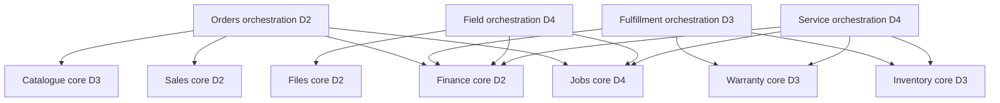

# Technical Requirements Document — Sunshine

Revision: 31 October 2026. Status: selected architecture and technical acceptance baseline. **Only the scaffold, platform User migration, live health/readiness and shared contracts exist.** Business endpoints, security controls, domain schemas, seed and rehearsals described here remain planned.

## 1. Constraints and stack

User-required constraints: local PostgreSQL/MySQL, own APIs, dynamic persisted data, minimal external APIs, validation, consistent UI and all-team contributions. Chosen: Node 22, React/Vite/TypeScript, Tailwind/selected primitives, NestJS REST modular monolith, Prisma, PostgreSQL 17 and private local files. The scaffold pins newer Nest/Prisma majors than the team's previous project; [technology decisions](architecture/technology-decisions.md) explain alternatives, version familiarity and compatibility evidence.

No BaaS, microservices, queues, distributed workflow platform or AI in committed scope. One company/warehouse, one application release, database and uploads persistent locally. A permitted cloud deployment can use the same topology; specific event hosting requirements remain unverified.

## 2. Repository and ownership boundaries

`apps/web` is D1; backend `platform/auth/sales/finance/files/subsidy` is D2, `catalog/inventory/fulfillment/warranty` is D3, and `field/service/reporting` is D4. `packages/contracts` contains shared request/response schemas; `prisma` is a reviewed domain-owner migration queue coordinated by D3. D2 owns shared runtime/config/release. See [roles](team/roles.md) and [contribution rules](team/contributing.md).

Modules export narrow transaction-aware helpers; no hidden independently committed nested calls. Avoid circular module imports: orchestration depends on published service interfaces; low-level stock, finance and job primitives must not import the top-level orchestrator that calls them.

## 3. Data model and relational integrity

Use [the model/ERD](architecture/data-model.md) for entities and relationships. UUID PKs; FKs; scoped normalized serial uniqueness; one active unit allocation; quote-line XOR ticket-line allocation source; positive quantities; explicit statuses and indexes. Money uses decimal strings/SQL numerics, quantity precision and rounding are documented; UTC storage with Asia/Kolkata business periods.

Package template and accepted quote snapshot are separate. Quote line type distinguishes package charge, component requirement and service. Allocations identify actual units/bulk stock. Current on-hand/reserved balances and immutable movements reconcile. Serial acquisition cost and bulk weighted-average receipt cost are frozen into consumption; no duplicate purchase/consumption expense.

Files retain uploader and authorized record association. Ticket/time/file/job/customer must agree across relationships. Replacement links old/new unit with retained history and quarantines old equipment; do not overwrite serial identity or silently restart warranty.

## 4. API and validation contract

REST prefix `/api/v1`; JSON `{data}` success and `{error:{code,message,fieldErrors,requestId}}` failures. Use the shared Zod schema at runtime on server and client; client checks improve usability but do not replace server validation. Return 400 invalid input, 401/403 access, 404 unavailable record, 409 conflict/transition/version and 503 temporary service failure. Only the two health endpoints exist today.

Routes, ownership and helpers are in [API contracts](architecture/api-contracts.md). Mutations accept only allowed fields; do not trust browser-supplied totals, roles, customer scope, coverage status or stock availability. Request limits, pagination and bounded filters prevent accidental unbounded work.

## 5. Transactions and retries

| Command | Atomic effects |
|---|---|
| Quote creation | Check approved survey; freeze package/quantity/price/policy facts |
| Order confirmation | Accepted terms/order + one job + invoice + packing obligations + audit/command result |
| Receipt | Unique payment reference, invoice balance/readiness and audit/command result |
| Stock reservation | Lock balance/units in stable order; all component requirements or none |
| Dispatch | Check all required scans, post stock and actual job cost once |
| Delivery | First completion and per-unit warranty activation once |
| Field completion | Validate time/kW/persisted evidence and acceptance, then update job |
| Repair/replacement | Saved coverage decision; actual stock/time/cost; chargeable invoice once; old/new lineage |
| Ticket closure | Require recorded customer confirmation |

Critical commands require an actor-scoped idempotency key plus payload hash, business action and recorded result in one transaction. Same key/body returns saved result; different body conflicts. Bounded transaction-conflict retries only. No upload/network calls while locks are held. No success response before commit.

## 6. Scan and evidence semantics

Store raw/normalized value, unit, order/dispatch, actor, time and method (`CAMERA`, `SCANNER`, `TYPED`). All required serialized units must have accepted scan records before exit; typed entry is not scan evidence. Reject unknown, wrong product, another job's unit, duplicate dispatch input and already-installed unit. Test actual hardware/format; do not assume browser BarcodeDetector support.

Reject installation completion without valid nonfuture start/finish, kW, photo and signature. Upload limits/type checks/private authorized downloads; failed/pending uploads do not count. Files are not publicly static served. Evidence/identity claims stop at what is actually checked: no certified signature, GPS or photo-authenticity claim.

## 7. Coverage and financial semantics

Warranty interval is `start <= assessed < expiry`; expiry/calendar/leap rules tested. Save policy revision, dates, scope and explanation. Component and optional service cover are separate. Customer charge, internal cost and supplier claim status remain separate. Supplier recovery is not revenue/cash simply because a claim is pending.

Covered repair: customer price zero, actual parts/time costs still post to original job. Expired/no-active-service sample: parts/labour invoice generated once. Resolution precedes staff-recorded customer confirmation, which precedes closure. Reversal corrects posted money/stock; editing history is not the correction mechanism.

Source ownership prevents repair double-counting: D3 posts consumed parts with the stock-movement source ID; D4 posts labour with the time-entry source ID via FinanceService. Ticket total is their sum, not a second expense row. Replacement delivery explicitly distinguishes a normal new sale from continuation of covered equipment; new unit coverage links to the original policy/expiry rather than calling the standard new-sale activation path blindly.

Report distinct measures: (a) period posted invoices, (b) period receipts/disbursements, (c) period occurred costs, (d) lifetime job contribution as of cutoff, with completed jobs separate from provisional unfinished work. Do not subtract a lifetime cost base from a month-only invoice total and call it monthly profit. Use half-open IST day/week/month bounds converted to UTC. The [oracle](planning/demo-seed-oracle.json) provides synthetic pre-tax expected values, not hardcoded KPI output.

## 8. Security and roles

Persistent server sessions, password hashing, logout/revocation, HttpOnly/SameSite cookies, Secure on HTTPS, CSRF and explicit trusted-proxy/origin settings where used. Every record/download checks role and relevant job/customer assignment. Technician time actor and staff recorder are not silently treated as the same person. Public enquiry gets validation/rate limiting; no public reset/seed route. Logs/errors omit credentials and internal exception details. These controls are requirements, not scaffold features already implemented.

## 9. Runtime, files and phone topology

Local Compose contains PostgreSQL and the Nest-served frontend/API; native dev uses Vite proxy plus API. Both API modes use port 3001, so stop the other mode first. Default host bindings are loopback; phone Wi-Fi does not work automatically. Use tested Android USB localhost forwarding or separately configured trusted LAN HTTPS; valid certificate trust and secure context matter for browser camera. Keep PostgreSQL private. See [runbook](planning/demo-runbook.md) for the real-device gate and supported fallbacks.

Migrations are explicit; startup never destroys/reseeds data. A future demo seed uses an explicitly disposable database and stable/run-prefixed fixture IDs, preserving/recreating staff identity as needed. Historical dates must pass the same consistency rules as real records; no global clock override. Back up database plus matching private files and test restore on a second host.

## 10. Nonfunctional acceptance targets

| Area | Target / proof |
|---|---|
| Query usability | On agreed demo dataset/hardware, normal lookup <=2s; record actual measurements rather than claim scalability |
| Intake visibility | Valid public submission visible <=3s on chosen local topology and persists after refresh |
| Correctness | Two-connection allocation has one winner; retries cause one business effect; reports reconcile |
| Responsiveness | Forms usable at 360px width, keyboard/focus/labels/errors checked; actual phone evidence flow tested |
| Availability/recovery | Clear DB-unavailable state; prepared local release can start/restore without venue internet |
| Traceability | Every material action has actor/time/source; equipment and financial history preserved |
| Maintainability | One owner per module, shared contracts, reproducible migrations/lockfile, small reviewed commits |

These targets are not production SLAs or observed load-test results. Forty jobs/month does not itself prove a response-time guarantee.

## 11. Verification and release

Scaffold `npm run check` covers docs/schema/type checks/contracts/build; smoke covers infrastructure. [Testing](planning/testing.md) adds future real-PG, API, field, security and browser acceptance. [Plan checker](../scripts/check-plan.mjs) checks planning structure/arithmetic/schedule assumptions only. Required application tests must actually run before marking a feature done.

Feature and integration gates follow the resource-leveled [build plan](planning/demo-build-plan.md) and [backlog](planning/build-backlog.json). Before release: migration replay, DB/file restore, complete R1–R25 proof, actual query reconciliation, device/scan check, three timed short presentations, all-member commits and organizer-specific field confirmation. Do not replace missing P0 with static/demo-only outcomes.

## 12. Precise implementation defaults

- Event times are UTC timestamps. New-sale warranty start/expiry are IST **calendar dates**, derived from delivery occurrence time; expiry is exclusive. Adding calendar months clamps an invalid day to that month's final day (e.g. February 29 anniversary); test and document that chosen policy rather than relying on JavaScript rollover. Preserve original delivery timestamp and policy revision.
- Use Prisma Decimal/SQL numeric for money arithmetic, constructed from decimal strings. Round at stated invoice-line boundaries to two decimals with half-up rounding; sum rounded lines and separately show tax. Do not use binary JS floats for production amounts. Oracle integers are planning checks, not financial implementation.
- Invoice lines have configurable tax rate/amount fields. Demo default is zero with an explicit **tax not configured / pre-tax management example** label, not a claim of legal zero rating. No hardcoded 12% or subsidy slabs.
- Search/latency claims need dataset/hardware evidence. R16 targets <=2s; if claiming long-term volume support, measure indexed lookup on approximately 2,400 jobs/20,000 units (five-year illustration), not ten rows. Do not claim that benchmark has run.
- List pagination defaults to 25, maximum 100. Poll the active sales enquiry queue every 2s while visible so the <=3s visibility target remains testable; poll other work queues about every 10s. Refetch after mutations. Preserve drafts on request failure, use bounded retry, never optimistic stock/money.
- CSV quotes/escapes strings and neutralizes spreadsheet formulas in text cells (including leading whitespace and `=`, `+`, `-`, `@`, tabs/returns). Valid typed negative numeric contribution remains a numeric value, not a corrupted string. Default export omits unnecessary phones/addresses.
- File paths are server-generated keys, never client-supplied filesystem paths. Validate declared and detected type/size; access by authorized record. Orphan uploads are not completion evidence and can be cleaned after a documented age. No raw personal data/credentials in logs.
- Code 128 sample labels and scanner Enter suffix/focus/debounce are tested on actual hardware. Camera decoder/browser availability is checked rather than assuming BarcodeDetector. Scan method is retained and `TYPED` cannot satisfy a required scan.

## 13. Dependency direction and runtime contract

Owner grouping is not one giant Nest module per developer. Export narrow core services without importing their orchestrators:

Finance core uses Prisma and posting inputs; it does not import Sales/Inventory/Service orchestration. Jobs core exposes creation/assignment primitives without importing Orders. Inventory/Warranty core do not import Service. Reporting reads query projections without importing all mutation services. No `forwardRef` to mask circular ownership; add a boundary check when those modules exist. Do not mutate another domain's tables directly outside its published helper.

| Contract detail | Decision |
|---|---|
| Idempotency scope | Staff actor + command type/target + key; hash payload; replay original committed result |
| Retention | At least the demonstration/event window; no eviction while retries could double-post. Permanent unique business sources protect money/stock beyond replay retention |
| Version conflict | Request includes current version; stale write is 409 `STALE_VERSION`, preserve form input, refetch |
| Representative errors | 400 `INVALID_INPUT`; 403 `FORBIDDEN`; 409 `SURVEY_NOT_APPROVED`, `INSUFFICIENT_STOCK`, `UNIT_ALREADY_ASSIGNED`, `REQUIRED_SCAN_MISSING`, `EVIDENCE_REQUIRED`, `CUSTOMER_CONFIRMATION_REQUIRED`, `IDEMPOTENCY_CONFLICT`; 503 `SERVICE_UNAVAILABLE` |
| Runtime variables | Current `.env.example`: DB connection/credentials/port, API port, upload directory, environment. Future auth adds a strong secret/origin/proxy settings; demo seeding adds explicit disposable-DB guard. None is a hidden production reset flag today |
| Logs | Request ID, safe action/status/time/actor ID; no password/session token, raw signature/photo or customer contact body |
| Browser/device target | Supported current Chrome desktop plus actual chosen Android/iPhone browser/device recorded at rehearsal; emulator is not a real phone |

All staff seed credentials are local-demo-only and never reused elsewhere. Every team member makes their own reviewed commits and explains their work; an agent-authored scaffold commit is not evidence of four human contributors.
