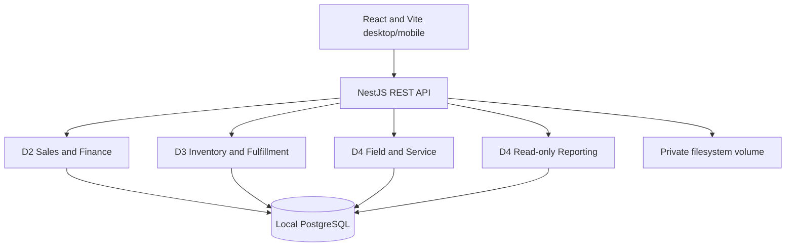

# Current technical architecture

Status: selected implementation direction. Only the foundation described in the root README is implemented. Earlier mixed-topic architecture files in the research archive are historical.

## Stack decision

React/Vite/TypeScript + Tailwind; NestJS REST modular monolith; Prisma; local PostgreSQL; private filesystem uploads; eventual server-side cookie sessions. Nest serves the compiled SPA for one deployed origin. This internal dashboard needs neither SEO/SSR nor separate frontend/backend hosting. Team familiarity is with the patterns; this scaffold pins Nest 12/Prisma 7 and was checked on Node 22. Do not equate familiar concepts with identical version experience. See the [full stack comparison and reasoning](technology-decisions.md).

The supplied deliverables explicitly require local relational storage/custom APIs and exclude Supabase/BaaS. Vercel plus a remote DB is therefore not the baseline. No Redis, queues, Kafka, Kubernetes, AI, or distributed workflow platform is required.

## Boundaries

- Controllers validate requests; services enforce authorization and state transitions; critical effects share one database transaction.
- Cross-module helpers receive `tx`; they do not open independently committed nested transactions.
- Confirmation creates job/invoice/packing requirements. Payment is recorded separately and gates allocation/work.
- D2 owns finance writes. D3 posts material costs through that helper. D4 posts time/repair costs through it and reads reports.
- Delivery activates coverage through D3. D4 assesses the applicable coverage, records reasons, and orchestrates repair/replacement.
- Photographs/signatures upload outside the business transaction; only completed authorized file records satisfy evidence requirements.
- Same-origin REST with shared Zod request/response contracts. Poll active queues; no sockets required.
- Online first. A local runnable demo is not offline browser synchronization. No unconfirmed offline stock, payment or coverage commands.

## Authentication to implement

D2: seeded staff accounts, password hashing, PostgreSQL-backed session middleware, HttpOnly/SameSite cookies, Secure on HTTPS, CSRF on mutations, role/record checks on every operation and download. No insecure role-picker or fake login. Public enquiry endpoint gets validation/rate limiting. The current scaffold has no login or protected business endpoints.

## Six UI workspaces

Overview, Sales, Orders, Warehouse, Field & Service, Reports. Use shared list/detail/form/timeline/action/summary patterns. Scan, photo upload and signature are tested before spending time on dashboard polish. Every screen is owned by D1; API owners join fixed integration slots.

## Sources and tradeoffs

- [Nest static SPA serving](https://docs.nestjs.com/recipes/serve-static)
- [Next self-hosting](https://nextjs.org/docs/app/guides/self-hosting): viable alternative, not required here.
- [Prisma transaction reference](https://docs.prisma.io/docs/orm/v7/prisma-client/queries/transactions)
- [PostgreSQL row locking](https://www.postgresql.org/docs/17/explicit-locking.html)
- [OWASP session guidance](https://cheatsheetseries.owasp.org/cheatsheets/Session_Management_Cheat_Sheet.html)

Freeze compatible versions in the lockfile after installation/build smoke checks. Do not perform an unbounded major upgrade during the build.
