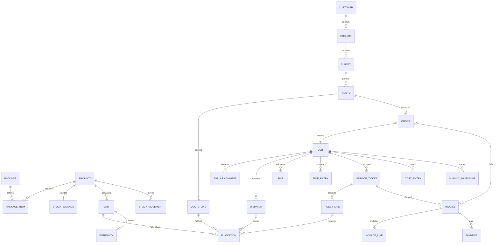

# Planned data model and integrity rules

**Implementation status:** `prisma/schema.prisma` currently contains only the User foundation and its initial migration. The domain model below is a reviewed plan, not an already implemented schema. D3 coordinates migrations; each backend owner authors their own domain changes.

One company and one warehouse. UUID PKs, explicit FKs/statuses, UTC timestamps, optimistic `version` on mutable workflow records, `numeric(14,2)` money, `numeric(12,3)` quantities. API money is a decimal string with documented rounding.

| Models to add | Owner | Principal relationship / constraint |
|---|---|---|
| Session | D2 | Persistent staff session; expires and revokes |
| Customer, Enquiry | D2 | Contact, address, source, follow-up owner/date |
| Survey | D2 | Approved revision immutable; records technician/measurements/approval |
| Product, Package, PackageItem | D3 | SKU unique; capacity/type/revision; reusable BOM components |
| Quote, QuoteLine, Order | D2 | Quote references approved survey; accepted quote immutable; unique order per quote |
| Job, JobAssignment | D4 | One job per order; assigned technicians and schedule |
| StockBalance, Unit, StockMovement | D3 | Quantity/physical serial distinct; actual receipt cost; immutable movements |
| Allocation, Dispatch | D3 | Quote-line XOR ticket-line source; actual selected equipment and dispatch |
| Warranty | D3 | Unique unit; delivery start; stored expiry and policy snapshot |
| File | D2 | Private key/type/size/uploader and authorized job/ticket association |
| TimeEntry | D4 | Job/ticket, technician, time and frozen pay/cost rates |
| ServiceTicket, TicketLine | D4 | Unit/job, fault, saved coverage reasoning, parts/labour, customer confirmation |
| Invoice, InvoiceLine, Payment, CostEntry | D2 | Unique posting sources; posted records corrected through reversal |
| SubsidyMilestone | D2 | Job/stage/owner/status/dates/evidence; queryable unfinished work |
| AuditEntry, Command | D2 | Actor/change/reason; actor-scoped idempotency keys and result |

## BOM and price snapshots

`PackageItem` is a template. `QuoteLine` freezes sold requirements; `Order` references the immutable accepted quote. Line types PACKAGE, COMPONENT and SERVICE separate customer price from stock requirements. Components do not charge the package price twice. Allocations name physical units/bulk quantities, not template rows alone.

## Stock invariants

- Unique normalized serial by manufacturer/product; retain original scan and stable unit UUID.
- Partial unique index for one active unit allocation, retained through delivery/installation until return/replacement.
- Serialized allocation: unit set, quantity exactly 1. Bulk allocation: unit absent, positive quantity and bulk product. Product-mode matching is a transactional cross-table rule, not a simple CHECK.
- Exactly one allocation source: quote line XOR service ticket line. Repair parts/replacement do not modify the old sales BOM.
- Lock stock balance and units in stable order, check availability, and reserve all requirements or none.
- `0 <= reserved <= onHand`; dispatch decrements both, posts movement and frozen consumed cost exactly once.
- Goods receipt records reference/quantity/unit cost. Serial units keep acquisition cost; bulk uses locked weighted-average cost frozen at dispatch. Do not expense both purchasing and consumption as job material cost.
- Replacement releases old active equipment into quarantine, links old/new, posts actual movements and costs. Replacement coverage continuation is explicit; never silently restart a long warranty.

## Coverage and field invariants

- Standard sales delivery completion sets warranty start/expiry once; retries never extend it.
- Coverage interval: `start <= assessmentDate < expiry`; calendar-year/leap-day rules explicit.
- Record component coverage, service coverage, scope, customer charge, internal cost, supplier claim status and reasoning separately. Warranty does not guarantee supplier reimbursement.
- Installation completion requires timestamps, confirmed kW size, checklist/photos and homeowner signature evidence.
- Ticket resolution is separate from closure. Closure requires customer confirmer, channel and timestamp; staff-recorded phone confirmation is labeled honestly.

## Finance definitions

- Posted invoice value is invoiced revenue; cash received is separate. Booking receipts do not create revenue a second time.
- Estimated, committed and actual/billed margin are labeled separately; unfinished work is visible.
- Job material cost comes from actual dispatched units/bulk costs; labour/repair cost is job-tagged once through unique sources.
- Repairs can cost the company while customer charge is zero. Expired chargeable repairs produce one invoice with parts/labour lines.
- Payments reference an invoice; multiple partial receipts are supported. Duplicate external references/retries cannot double balances.
- Cash reflects receipts/recoveries minus refunds and actual disbursements. A subsidy paid to the customer is not installer cash.
- Posted financial and stock corrections use reversal records, not destructive edits.

## Indexes

Enquiry owner/status/follow-up; survey approval/technician; order customer/status; job schedule/status; normalized serial; active allocation/source; warranty expiry; ticket status/unit/job; invoice due/status; cost job; subsidy responsible party/status.

## Deferred

Multi-warehouse, purchase-order management, general ledger, notification delivery, full payroll, maintenance contracts and user-configurable workflow engines. A receipt and pay summary still exist in P0.

