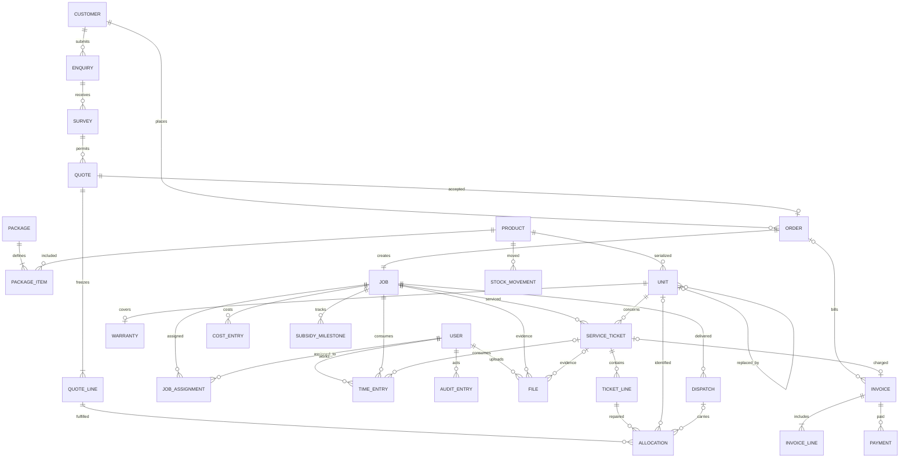

# Planned data model and integrity rules

**Implementation status:** `prisma/schema.prisma` currently contains only the User foundation and its initial migration. The domain model below is a reviewed plan, not an already implemented schema. D3 coordinates migrations; each backend owner authors their own domain changes.

One company and one warehouse. UUID PKs, explicit FKs/statuses, UTC timestamps, optimistic `version` on mutable workflow records, `numeric(14,2)` money, `numeric(12,3)` quantities. API money is a decimal string with documented rounding.

| Models to add | Owner | Principal relationship / constraint |
|---|---|---|
| Session | D2 | Persistent staff session; expires and revokes |
| Customer, Enquiry | D2 | Contact, address, source, follow-up owner/date |
| Survey | D2 | Approved revision immutable; records technician/measurements/approval |
| Product, Package, PackageItem | D3 | SKU unique; capacity/type/revision; reusable BOM components |
| Quote, QuoteLine, Order | D2 | Quote references approved survey; accepted quote immutable; unique order per quote |
| Job, JobAssignment | D4 | One job per order; assigned technicians and schedule |
| StockMovement, Unit, stock documents | D3 | Quantity/physical serial distinct; actual receipt cost; on-hand derived from immutable movements (see Stock ledger) |
| Allocation, Dispatch | D3 | Quote-line XOR ticket-line source; actual selected equipment and dispatch |
| Warranty | D3 | Unique unit; delivery start; stored expiry and policy snapshot |
| File | D2 | Private key/type/size/uploader and authorized job/ticket association |
| TimeEntry | D4 | Job/ticket, technician, time and frozen pay/cost rates |
| ServiceTicket, TicketLine | D4 | Unit/job, fault, saved coverage reasoning, parts/labour, customer confirmation |
| Invoice, InvoiceLine, Payment, CostEntry | D2 | Unique posting sources; posted records corrected through reversal |
| SubsidyMilestone | D2 | Job/stage/owner/status/dates/evidence; queryable unfinished work |
| AuditEntry, Command | D2 | Actor/change/reason; actor-scoped idempotency keys and result |

## BOM and price snapshots

`PackageItem` is a template. `QuoteLine` freezes sold requirements; `Order` references the immutable accepted quote. Line types PACKAGE, COMPONENT and SERVICE separate customer price from stock requirements. Components do not charge the package price twice. Allocations name physical units/bulk quantities, not template rows alone.

## Stock invariants

- Unique normalized serial by manufacturer/product; retain original scan and stable unit UUID.
- Partial unique index for one active unit allocation, retained through delivery/installation until return/replacement.
- Serialized allocation: unit set, quantity exactly 1. Bulk allocation: unit absent, positive quantity and bulk product. Product-mode matching is a transactional cross-table rule, not a simple CHECK.
- Exactly one allocation source: quote line XOR service ticket line. Repair parts/replacement do not modify the old sales BOM.
- Lock in the global order (see Stock ledger), check availability, and reserve all requirements or none.
- `0 <= reserved <= usable on-hand` when allocating; dispatch posts one movement and frozen consumed cost exactly once, and takes the allocation out of RESERVED.
- Goods receipt records reference/quantity/unit cost. Serial units keep acquisition cost; bulk uses locked weighted-average cost frozen at dispatch. Do not expense both purchasing and consumption as job material cost.
- Replacement releases old active equipment into quarantine, links old/new, posts actual movements and costs. Replacement coverage continuation is explicit; never silently restart a long warranty.

## Stock ledger (owner decision, 31 Oct)

Stock is a derived ledger: on-hand is never stored, only calculated from movements. All of it is written fresh for Sunshine, following the rules below.

**Core rules**

- **Append-only movements.** Each `StockMovement` has a positive quantity and a from-location, a to-location or both, which set its direction. CHECKs enforce both rules, and a trigger refuses UPDATE and DELETE. A correction is a new movement.
- **One writer.** A single function posts movements, using the caller's transaction. Nothing else writes that table.
- **Derived on-hand.** On-hand per product and location is movements in minus movements out, read from one database view with exact decimals.
- **Never negative.** An outgoing movement locks its (product, location) for the rest of the transaction, reads on-hand inside it, and refuses with 409 `INSUFFICIENT_STOCK` if there isn't enough.
- **Documents post once.** Receipts, deliveries, transfers and adjustments have a header and lines, with statuses DRAFT, WAITING, READY, DONE and CANCELED. Validation first claims the document with a conditional update, so one caller wins, then posts all its lines or none. DONE is reachable only through validation. A DONE document can't be edited or cancelled.
- **Counts.** An adjustment measures on-hand under the lock at validation, not when drafted, and posts the difference.
- **Stock reads.** On-hand, reserved, free, incoming, forecast, OK/LOW/OUT status, reorder suggestion, per-location breakdown, stock value, paged and filtered movement history, and stock as of a past time.
- **Integrity report.** A read-only check over one snapshot: the view matches the movements, no balance is negative, each DONE document posted exactly once, no movement sits on a document that isn't DONE, and every movement is well formed.

**Sunshine's additions**

- **Global lock order.** Product rows by ID, then (product, location) locks sorted, then Unit rows by ID, in every command. Test opposite-order documents and a receipt racing a dispatch.
- **Reservations.** Allocation checks free stock under the same lock. Free is usable on-hand minus RESERVED allocations. Only RESERVED reduces free stock, because dispatched goods have already left the ledger. RESERVED, DISPATCHED, DELIVERED and INSTALLED all hold the one-active-per-unit index. Transfers refuse to take a location below its RESERVED quantity. A count below RESERVED is recorded truthfully, flagged by the integrity report, and blocks readiness.
- **Which commands move stock.** Receipts, dispatch, returns, transfers and adjustments post movements. Delivery and installation only change status, so stock is never deducted twice.
- **Serial units.** `Unit` holds identity and a link table ties it to its movements. The integrity report also checks that serial counts per location match the view.
- **Quarantine.** Quarantine locations count in the physical view but not in usable on-hand, and can't be a dispatch source.
- **Cost.** Receipt lines store actual cost. Weighted average updates under a row lock on the Product, because receipts take no stock lock and the average spans locations. Dispatch freezes the cost and posts it through D4's single writer with source `STOCK_MOVEMENT:<id>`. Later price changes never alter posted cost.
- **Retries.** Critical commands use the shared idempotency table, so a retry returns the saved result instead of a second document.

## Coverage and field invariants

- Standard sales delivery completion sets warranty start/expiry once; retries never extend it.
- Coverage interval: `start <= assessmentDate < expiry` over IST calendar dates, stored as date-only values; retain delivery occurrence as UTC separately. Clamp invalid month-anniversary days to month end and test that selected policy, including leap day.
- Record component coverage, service coverage, scope, customer charge, internal cost, supplier claim status and reasoning separately. Warranty does not guarantee supplier reimbursement.
- Installation completion requires timestamps, confirmed kW size, checklist/photos and homeowner signature evidence.
- Ticket resolution is separate from closure. Closure requires customer confirmer, channel and timestamp; staff-recorded phone confirmation is labeled honestly.

## Finance definitions

- Posted invoice value is invoiced revenue; cash received is separate. Booking receipts do not create revenue a second time.
- Estimated, committed and actual/billed margin are labeled separately; unfinished work is visible.
- Job material cost comes from actual dispatched units/bulk costs; labour/repair cost is job-tagged once through unique sources.
- D3 posts each consumed part from its stock-movement source; D4 posts labour from its time-entry source through D2's finance helper. A ticket repair total is an aggregation, not another cost posting. Otherwise the same part could be counted both as inventory consumption and as a ticket expense.
- Repairs can cost the company while customer charge is zero. Expired chargeable repairs produce one invoice with parts/labour lines.
- Payments reference an invoice; multiple partial receipts are supported. Duplicate external references/retries cannot double balances.
- Cash reflects receipts/recoveries minus refunds and actual disbursements. A subsidy paid to the customer is not installer cash.
- Posted financial and stock corrections use reversal records, not destructive edits.

## Indexes

Enquiry owner/status/follow-up; survey approval/technician; order customer/status; job schedule/status; normalized serial; active allocation/source; warranty expiry; ticket status/unit/job; invoice due/status; cost job; subsidy responsible party/status.

## Deferred

Multi-warehouse, purchase-order management, general ledger, notification delivery, full payroll, maintenance contracts and user-configurable workflow engines. A receipt and pay summary still exist in P0.

Replacement's optional old-unit link is stored on the new unit; an old unit may have zero or more historical replacements, while only one active installation/assignment is permitted. The schema freeze must add appropriate FKs and cross-record job/customer matching checks; this ERD is not an already migrated schema.
