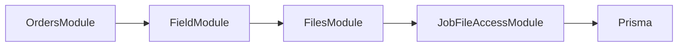

# Job file authorization policy

Status: accepted by D3 for S03 implementation. [Recorded decision](https://github.com/Muzaffar-codes07/sunshine/pull/39#issuecomment-6547084464). Depends on [private Files transport, PR32](https://github.com/Muzaffar-codes07/sunshine/pull/32). Implemented by [S03, PR49](https://github.com/Muzaffar-codes07/sunshine/pull/49) in `apps/api/src/field/job-file-access.ts`, which registers the JOB provider. TICKET files stay closed until D4 supplies its adapter.

## Existing facts

Main after scheduling PR40 (60994e8) has a real Job linked to one Order and a JobAssignment table. A current assignment is a job_assignments row for the job and technician with removedAt null. Removed rows preserve history and grant no access. SCHEDULED is the initial job status; it is not assignment proof.

The Order and accepted Quote provide customer, enquiry and sold-system facts. The job helper verifies those facts and creates the job inside confirmation's transaction.

Files exposes FILE_RECORD_AUTHORIZER.assertAccess(tx, actor, {contextType, contextId}, action), where action is UPLOAD, DOWNLOAD or ATTACH. Its production default refuses bound access when the adapter is absent. Unbound uploads belong to their uploader and are not completion evidence. See [TRD ownership and evidence rules](../TRD.md).

## Accepted permission matrix

| Actor | Download JOB file | Upload or attach JOB file |
|---|---|---|
| ADMIN | Allow for an existing consistent job | Allow unless COMPLETED |
| SALES | Allow for an existing consistent job | Deny |
| TECHNICIAN with a current D3-authorized assignment | Allow | Allow unless COMPLETED |
| TECHNICIAN without that assignment | Deny | Deny |
| WAREHOUSE or SUPPORT | Deny | Deny |

D3 accepted this matrix for S03 implementation. Staff identity comes from AuthGuard, never the upload body. Signing in alone grants no record access.

D3 queries current assignment in the caller transaction: jobId and technicianId must match an active job_assignments row (removedAt null). Multiple active crew members may qualify. Removing an assignment revokes access immediately, including for the original uploader. A missing authorization dependency continues to fail closed.

No upload or attach is allowed on a COMPLETED job. Those actions stay open in SCHEDULED, IN_PROGRESS and AWAITING_ACCEPTANCE subject to the matrix. Download continues to follow the matrix. Correcting completed evidence needs a separate decision; it does not silently unfreeze the job.

## Record checks inside the caller transaction

1. Require JOB context and load the actual job by contextId. Route TICKET context to D4's own adapter; a missing adapter continues to fail closed.
2. Resolve the order through Job.orderId and require its jobId to point back to this job.
3. Resolve the accepted quote and enquiry through the order. Require the order, quote and enquiry to agree on customer/enquiry identity. Derive those facts; do not copy them into Job or trust client-supplied customer IDs.
4. Apply the role/assignment rule for this action, using current database facts.
5. Refuse upload or attach when the job is COMPLETED.

Use the shared safe error envelope: forbidden actor 403, unavailable record 404, upload or attach on a COMPLETED job 409 (`JOB_ALREADY_COMPLETED`), unconfigured authorization dependency 503. A broken internal relationship refuses access with 503 (`JOB_RECORD_INVALID`) and a request ID. Never return a server storage key or filesystem path.

Files core still enforces uploader ownership for an unbound attachment and prevents moving a bound file to another record. An ADMIN entry in the matrix does not override either invariant. Once bound, original uploader status alone does not grant download access after reassignment.

## Module placement

Use a small D3-owned JobFileAccessModule that reads through the supplied Prisma transaction. Keep it independent of the FieldModule that orchestrates job completion.

The FieldModule-to-FilesModule edge is for the later completion workflow. Files imports only the low-level access module, so a completion command can use Files without creating a module cycle. The access adapter performs database reads only; no file/network I/O or independent commit.

D3 owns the S03 adapter. PR49 implemented it with its integration proof, and FilesModule now imports JobFileAccessModule. A write takes `FOR SHARE` on the job row, so completion cannot commit between the check and the write.

## Evidence use by a completion command

Before a critical job/stock/money transaction, Files.download(fileId, actor) verifies private bytes, size and hash. In the transaction, Files.attach and/or requireEvidence enforce the exact JOB association and current domain access. D3 then checks the complete photo/signature/time/customer acceptance requirements before completing the job.

A successful upload is not a completed installation or an authenticated customer signature. An orphan, missing blob, wrong-job file or unauthorized attachment cannot satisfy the gate.

## Integration proof required before enabling access (delivered in PR49)

- Check every matrix row for upload, download and attach against real job records.
- Verify current assignment changes revoke access, including for the original uploader; an unrelated technician cannot read or bind evidence.
- Refuse missing jobs and mismatched order/quote/enquiry/customer relationships.
- Keep TICKET access closed until D4's adapter is supplied.
- Verify rejected upload/attachment writes leave no usable metadata; caller rollback preserves the unbound state.
- Preserve immutable association under concurrent attempts to attach one file to different jobs.
- Prove missing/altered bytes fail preflight and that completion uses persisted, correctly bound metadata inside its transaction.
- Prove COMPLETED refuses upload/attach while other statuses follow the matrix; downloads still require current role/assignment.

The role matrix, assignment authority, job-stage rule and module placement are accepted in the linked D3 decision. PR49 delivered the D3-owned S03 implementation and this proof. The remaining gap is TICKET access, which needs D4's adapter.
