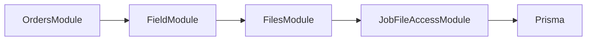

# Proposal: authorize files attached to a job

Status: draft for D3 decision. Proposer: D2. Depends on [private Files transport, PR32](https://github.com/Muzaffar-codes07/sunshine/pull/32) and D3's assignment design. This document grants no access and registers no runtime provider.

## Existing facts

Main at a64fee9 has a real Job linked to one Order, with status/version/timestamps and allocation relations. It has no technician assignment field or assignment table. SCHEDULED is the initial job status; it is not proof that a technician is assigned.

The Order and accepted Quote provide customer, enquiry and sold-system facts. The job helper verifies those facts and creates the job inside confirmation's transaction.

Files exposes FILE_RECORD_AUTHORIZER.assertAccess(tx, actor, {contextType, contextId}, action), where action is UPLOAD, DOWNLOAD or ATTACH. Its production default refuses bound access when the adapter is absent. Unbound uploads belong to their uploader and are not completion evidence. See [TRD ownership and evidence rules](../TRD.md).

## Proposed permission matrix for D3 to accept or change

| Actor | Download JOB file | Upload or attach JOB file |
|---|---|---|
| ADMIN | Allow for an existing consistent job | Allow, subject to D3's job-stage rule |
| SALES | Allow for an existing consistent job | Deny |
| TECHNICIAN with a current D3-authorized assignment | Allow | Allow, subject to D3's job-stage rule |
| TECHNICIAN without that assignment | Deny | Deny |
| WAREHOUSE or SUPPORT | Deny | Deny |

The matrix is a proposed product permission, not an implication of signing in. D3 must confirm it before enabling a provider. Staff identity comes from AuthGuard, never the upload body.

D3 supplies the authoritative current-assignment predicate in the caller transaction. This proposal chooses neither a schema nor a one-technician limit. Until that predicate and the role decision exist, technician access remains closed. A missing dependency is unavailable access, not an implicit assignment.

D3 must also decide whether completed jobs accept additional evidence. That stage decision belongs to the job workflow and must be checked for upload/attach if adopted.

## Record checks inside the caller transaction

1. Require JOB context and load the actual job by contextId. Route TICKET context to D4's own adapter; a missing adapter continues to fail closed.
2. Resolve the order through Job.orderId and require its jobId to point back to this job.
3. Resolve the accepted quote and enquiry through the order. Require the order, quote and enquiry to agree on customer/enquiry identity. Derive those facts; do not copy them into Job or trust client-supplied customer IDs.
4. Apply the approved role/assignment rule for this action, using current database facts.
5. Apply D3's adopted stage rule for mutation actions.

Use the shared safe error envelope: forbidden actor 403, unavailable record 404, unconfigured authorization dependency 503. A broken internal relationship refuses access with a safe error and a request ID. Never return a server storage key or filesystem path.

Files core still enforces uploader ownership for an unbound attachment and prevents moving a bound file to another record. An ADMIN entry in the matrix does not override either invariant. Once bound, original uploader status alone does not grant download access after reassignment.

## Module placement

Use a small D3-owned JobFileAccessModule that reads through the supplied Prisma transaction. Keep it independent of the FieldModule that orchestrates job completion.

The FieldModule-to-FilesModule edge is for the later completion workflow. Files imports only the low-level access module, so a completion command can use Files without creating a module cycle. The access adapter performs database reads only; no file/network I/O or independent commit.

Keep provider registration disabled until D3 accepts the matrix, supplies assignment authority and owns the implementation. A later implementation PR can import the approved access provider into FilesModule and exercise the real routes.

## Evidence use by a completion command

Before a critical job/stock/money transaction, Files.download(fileId, actor) verifies private bytes, size and hash. In the transaction, Files.attach and/or requireEvidence enforce the exact JOB association and current domain access. D3 then checks the complete photo/signature/time/customer acceptance requirements before completing the job.

A successful upload is not a completed installation or an authenticated customer signature. An orphan, missing blob, wrong-job file or unauthorized attachment cannot satisfy the gate.

## Required integration proof before enabling access

- Check every matrix row for upload, download and attach against real job records.
- Verify current assignment changes revoke access, including for the original uploader; an unrelated technician cannot read or bind evidence.
- Refuse missing jobs and mismatched order/quote/enquiry/customer relationships.
- Keep TICKET access closed until D4's adapter is supplied.
- Verify rejected upload/attachment writes leave no usable metadata; caller rollback preserves the unbound state.
- Preserve immutable association under concurrent attempts to attach one file to different jobs.
- Prove missing/altered bytes fail preflight and that completion uses persisted, correctly bound metadata inside its transaction.
- Prove the approved completed-job mutation rule once D3 chooses it.

D3 review should resolve the role matrix, assignment authority and job-stage rule. After those decisions, implementation can be reviewed separately with the existing Files transport tests.
