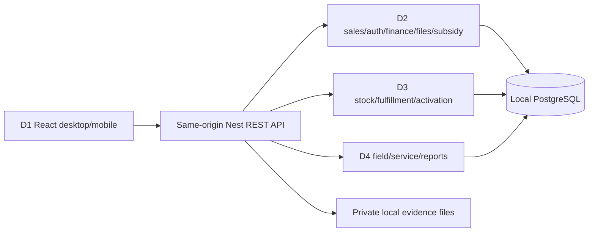
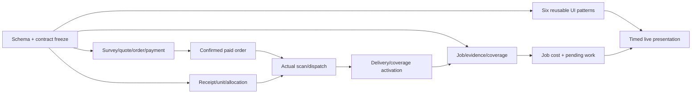

# Sunshine: full build plan for a defensible hackathon demo

Planning revision: 31 October 2026. **Only the infrastructure scaffold exists today.** All business tickets in the accompanying backlog are planned; this document is not a completion claim. The goal is a connected application the team can explain and demonstrate, not the largest feature list or a guarantee of winning.

Read this first, then use the [ordered backlog](build-backlog.json), [traceability matrix](requirements-traceability.csv), [demo runbook](demo-runbook.md), and [worked seed oracle](demo-seed-oracle.json). The [roles](../team/roles.md) remain one frontend developer and three backend owners.

## 1. Executive Recommendation

Build one order/customer workspace that makes the next action obvious. Connect enquiry, approved survey, frozen quote/BOM, invoice/advance, actual equipment, delivery, field evidence, service and job contribution. Use a short presentation to show a few strong transitions; retain a longer evaluator path to prove the entire brief.

Three things should be immediately visible: **which physical unit went to the customer; why a repair is free or charged; what that service cost does to the original job.** These are execution choices supported by the brief and research, not claims that incumbents lack them.

The current stack remains React/Vite, NestJS, Prisma and local PostgreSQL. No BaaS, AI, workflow engine, Redis or new deployment platform. Preserve the working scaffold and lockfile.

## 2. Verified Requirements and Assumptions

- Re-read [the PDF](../requirements/solar-problem-statement.pdf); [R1–R25](../research/solar/01-requirements-from-pdf.md) cover the six scenes. Every R remains P0 at simple depth and has a backend owner, ticket and observable acceptance condition in the traceability matrix.
- Follow the [supplied video deliverables](../requirements/organizer-video-deliverables.md): local relational DB, own APIs, dynamic data, graceful validation, coherent UI, all-team Git and presentation.
- The [specific event URL](https://hackathon.odoo.com/hackathon/details/69159) was inaccessible on recheck. The [general official page](https://hackathon.odoo.com/) supports hiring/teamwork and a 24-hour final, not this event's exact rubric weights or submission fields. Reconfirm those with organizers; do not invent them.
- Use relative hours as requested. H0 is a budgeting reference after the plan is accepted, not permission to reset a real event clock.
- One company/warehouse; manually recorded payments; no live WhatsApp/payment/government integrations; staff-recorded customer repair confirmation; explicit local demo accounts.
- Examples are synthetic, pre-tax management figures. No quoted GST/subsidy amount is asserted as current law. All code is written fresh; no source is copied from earlier projects.

## 3. Tech Stack Comparison

The [detailed comparison](../architecture/technology-decisions.md) evaluates the problem solved, speed, learning, integration, demo reliability, risk, alternatives and necessity for each decision. In brief: React/Vite avoids unnecessary SSR work; Nest provides explicit custom-API modules; Prisma and PostgreSQL support relational modeling with manual locking constraints; local files and a local release reduce external dependencies.

Familiarity means concepts, not identical versions: Sunshine pins Nest 12/Prisma 7. Existing CI/build/runtime checks establish scaffold compatibility only. Do not use that evidence to claim stock, auth, money or warranty correctness.

## 4. System Architecture

Business commands use short transactions and pass the same `tx` to helpers. Confirmation creates a job, invoice and packing requirements; recording payment is separate and gates stock allocation/work. No frontend-computed eligibility or financial totals. No separate worker required for the committed scope.

## 5. Database Design

Use the [data model and ERD](../architecture/data-model.md) as the schema-freeze checklist. D3 coordinates migrations; domain owners author their own models/constraints. Do not create broad CRUD screens for every table.

Critical boundaries: package template versus immutable sold BOM; stock quantity versus physical unit; one active serial assignment through installed state; quote-line XOR ticket-line allocation source; delivery-triggered warranty once; replacement lineage; invoice/receipt/cost sources unique; posted records corrected by reversal.

Cost source: receipts store actual unit costs. Serialized units keep acquisition cost; bulk uses locked weighted-average cost, frozen at dispatch. Do not count both purchase and consumption as job expense. File metadata refers to completed private uploads. Subsidy milestones are queryable records, not a vague blob.

## 6. Backend/API Design

Use [the endpoint and service contracts](../architecture/api-contracts.md). Publish request/response schemas and fixtures at H1.5. Exceptions carry a code, safe message, field errors and request ID.

| Boundary | Writer | Acceptance |
|---|---|---|
| Survey→quote | D2 | Server rejects unapproved/rejected survey |
| Quote→order/job/invoice | D2 orchestrates D4 job helper | Retried confirmation produces one of each |
| Payment→readiness | D2 | Duplicate reference/key cannot add money twice |
| Allocation/dispatch | D3 | Insufficient stock or serial conflict rolls back the entire command |
| Delivery→warranty | D3 | First delivery sets dates; repeat does not extend them |
| Field completion | D4 | Reject missing time, size, photo or signature |
| Ticket assessment | D4 | Store policy/date/scope/charge/reason; ambiguous case requires review |
| Repair/replacement | D4 orchestrates D3 stock and D2 finance | New/old equipment linked; original job receives actual cost |
| Resolution→closure | D4 | Confirmer, channel and time required |

Do not open a second transaction inside a helper, upload files while holding stock locks, silently retry non-idempotent commands, or turn a service ticket into an automatic supplier-reimbursement promise.

## 7. Frontend Architecture

Navigation remains Overview, Sales, Orders, Warehouse, Field & Service, Reports. The order workspace has Overview, Survey, Quote/BOM, Money, Equipment, Field Evidence and Service tabs. Keep current status, assigned person, customer and next permitted action visible.

D1 builds six patterns once: list, detail, form, timeline, action drawer, summary/reconciliation. The expensive interactions—scan/photo/signature—are validated early. Tables/cards come after working commands. Errors identify the field or next action; failed writes never show success.

No frontend developer should wait for three backend teams: each provides schemas and fixture payloads early, then joins its allocated integration slot. Final acceptance uses real APIs/PostgreSQL; fixtures are only development inputs or clearly seeded database records.

## 8. Four-Developer Responsibility Matrix

| Owner | Exact delivery slice | Exclusions / support |
|---|---|---|
| D1, sole frontend | All screens, reusable components, mobile interactions, API wiring, error/accessibility states | No stock, auth or finance rules in browser; D2 is emergency UI backup only |
| D2 backend | Auth/platform, sales/survey/quote/order, FinanceService, private file endpoints, subsidy milestones, release/submission | Single finance writer; does not implement D3 stock or D4 service rules |
| D3 backend | Catalogue/BOM templates, actual-cost receipts, serial stock, allocation/scan/dispatch/delivery/activation; migration queue | No direct finance writes or coverage decision; assist release if D2 overloaded |
| D4 backend | Jobs/assignments/evidence/time, ticket/coverage, repair orchestration, read-only reports/pay/CSV, presentation | Calls D2/D3 helpers; no duplicated financial or stock logic |

Each backend owner writes API/integration tests and examples. D2 owns submission checklist; D4 owns presentation/rehearsal. Everyone commits and explains a part. Detailed sixteen-field role descriptions remain in [roles](../team/roles.md).

The backlog budgets about 16 focused hours per developer, leaving the rest of 24 elapsed hours for breaks, reviews, interruptions and recovery. Estimates are conditional on simple screens, no integrations and the existing scaffold; they are not claims of demonstrated throughput.

## 9. Parallel Execution and Integration Strategy

Start D1 F01, D2 B01 and D3 I01 in parallel; D4 contributes job contracts and starts S01 after those inputs exist. H1.5 freezes initial schema/DTOs. Valid PostgreSQL fixture factories allow stock, coverage and ticket primitives to be coded before upstream sales controllers exist, without bypassing runtime rules. B12/I11/S13 join real domains; F08A/B/C join their UI. Code-ready is not integrated done; see the [delivery contract](../foundations/delivery-contract.md).

Use short branches and reviewed small merges every 60–90 minutes. D3 sequences migrations; D2 coordinates the release and shared config/lock changes; D1 owns UI routes/tokens. At each gate reserve consecutive 15-minute slots for D2, D3 and D4 with D1. Backend owners fix their payloads during the slot; D1 does not debug three API implementations alone.

## 10. 24-Hour Implementation Timeline

The [short four-lane schedule](execution-plan.md) and [backlog](build-backlog.json) now include a concrete resource-leveled candidate: one task per owner, coding prerequisites, real integration joins and three staggered half-hour breaks each. Under the estimates it finishes at H21.75, targets release H22.5 and preserves H22.5–24 for recovery/submission. This is a conditional schedule, not measured throughput. Claude’s sensitivity simulation puts a uniform 10% effort increase at H24.27: the estimates have less than 10% practical margin. Use the scope cuts at each gate, rather than consuming the final submission buffer. The scheduled joins are final acceptance passes; pair on live endpoints at H6/H12/H15 as they become available, and fix incompatible contracts immediately rather than waiting for the final joins. Earlier H8 full-sales/H16 full-demo gates were withdrawn because the assigned D2 work could not fit them.

| Gate | Observable acceptance | If missed |
|---|---|---|
| H1.5 | Initial schema/FKs/statuses, contracts/errors/fixtures and scanner/device choice agreed | Remove optional editor fields, not mandatory rules |
| H6 | Auth/enquiry integrated; hardware capability spike; actual-cost catalogue receipts and isolated job/coverage primitives | Fix foundation; use tested device path, not typed-as-scanned claims |
| H12 | Approved survey/frozen quote; finance writer; inventory commands tested with valid fixtures | Stop optional work and resolve shared-helper blockers |
| H13 | Live order confirmation creates one job/invoice/packing requirement; receipt changes readiness | Join D2/D4 real services; no static success |
| H15 | Scan/dispatch/delivery/activation endpoints ready; private evidence backend works | Fix required handoff before report polish |
| H19 | Feature freeze; sales/fulfillment joins and invariant tests; DB/files restore rehearsed | Critical fixes only; no scope/framework/hosting expansion |
| H20.75 | Field/service/report and all frontend joins pass; full evaluator path succeeds | Entire team repairs mandatory gaps; no optional polish |
| H22 | Three actual timed presentations and evidence check | Shorten presentation honestly, never fake required behavior |
| H22.5 | Release freeze and artifacts verified | Critical release fixes only |
| H22.5–24 | Recovery and actual submission checks | Disclose missing proof; do not silently fabricate completion |

Stagger meals and short breaks inside the broad phases. If actual time is shorter, re-estimate remaining work; the relative plan is not a reason to skip tests or claim nonexistent features.

## 11. MVP Scope and Prioritization

P0 is R1–R25 at simple depth: enquiry/qualification/follow-up; survey/approval; template quote/frozen BOM; order/invoice/payment; packing/schedule; stock receipt/allocation/scan/dispatch/delivery; warranty; field times/kW/photos/signature; lookup/free/charged repair/replacement/confirmed closure; actual costs/revenue/receivables/unfinished work/subsidy/pay/period filters/CSV.

Necessary implementation decisions are also P0: record authorization, validation, idempotency, atomic stock, money source uniqueness, correct dates, persistent files and clean startup. An explained coverage decision is a useful execution of R17/R18, not an optional chatbot.

P1 after P0: catalogue/template editors, bulk entry, richer service policies, portable handover pack, remote customer confirmation link. P2: offline browser synchronization, preventive maintenance, service reserve. Exclude AI, marketplace, engineering simulation, live government/payment/WhatsApp integration and full payroll.

Use the cut rules in the schedule. A required flow can be a small form/table; it cannot become a static dashboard or a hardcoded success. A USB scanner is a legitimate scanning alternative; manual typing is not evidence that camera scanning works.

## 12. Testing and Acceptance Criteria

Run [the test plan](testing.md) against a dedicated local test DB, not the demonstration DB. Two connections must attempt the same allocation; exactly one wins and movements/costs/balances reconcile. Repeat confirmation/payment/dispatch/delivery/repair posting with the same key and assert one business effect. Invalid inputs/transitions/evidence/role access must be rejected on the server.

Use [the worked oracle](demo-seed-oracle.json) for expected amounts, never hardcode those numbers into runtime reports. `npm run check:plan` checks planning coverage, dependencies, effort sums and arithmetic only; it does not execute business rules. Actual domain test names/results are required before marking tickets done.

Financial acceptance: distinguish period invoice/cash/cost activity from lifetime job contribution. A confirmed but unfinished job does not appear as completed-job profit. Periods use Asia/Kolkata civil-date boundaries converted to UTC and half-open intervals. Do not break the demo when the month rolls over or make older repairs disappear from their original job.

## 13. Deployment and Submission Plan

Use one local Compose release; the DB remains loopback-only. Native dev and Compose app both need port 3001: stop the app profile before starting native dev. The current scaffold is not directly reachable from a phone over Wi-Fi; [device setup](demo-runbook.md) specifies USB forwarding or a trusted HTTPS proxy and a real-device gate. No real phone has been tested by this documentation pass.

D2 verifies actual event fields and owns README/setup/env/release/submission; D3 owns migration/seed/ERD; D4 coordinates evidence and whole-team presentation. Video, public URL and evaluator access are recommended preparations unless current organizer instructions require them. Do not assert the general homepage establishes those requirements.

Prepare a second host, matching DB/files backup and known release image. Demonstrate a restore before H20. No normal startup reset. A future reset/seed command must require an explicitly disposable demo database, preserve/recreate staff accounts, avoid secrets, and remain inaccessible through production/public routes.

## 14. Three-Minute Demo Plan

Read [the operator runbook](demo-runbook.md). The recommended three-minute presentation uses clearly introduced prepared records at valid lifecycle stages, then real writes. This avoids pretending an installation physically happened in thirty seconds or rushing dozens of form actions. The full six-to-eight-minute evaluator path starts from a new enquiry and proves every required step.

The short presentation shows approval/BOM, actual serial scan/delivery/warranty, field evidence, a separately historical repair decision, and a reconciled job result. It explicitly identifies record changes. No global clock override, hidden automatic completion, static JSON, or seeded outcome presented as a live mutation.

All four explain their own work; one operator controls navigation to avoid keyboard/login handoff overhead. An authenticated admin may legitimately record the sample scenario; technician-specific access is proved separately. No role-picker bypass. Three consecutive rehearsals under 180 seconds are required before advertising the short script as achievable.

## 15. Risk Assessment and Contingencies

The ten ranked risks are in [the execution overview](execution-plan.md): D1 bottleneck, D2 load, double allocation, schema drift, financial double count, mobile/file failure, disconnected modules, release failure, coverage/replacement error, submission omission.

This revision adds specific mitigations: UI action budget and longer evaluator path; current-major compatibility statement; phone connectivity/secure-context gate; exact financial oracle; completed-job versus period activity labels; DB-and-file restore; a single owner for submission. Never recover from a failed live write by displaying an unrelated completed record without saying so.

## 16. Final Implementation Blueprint

Start in this order after implementation is authorized: D1 F01/F03 plus early F02 capability probe; D2 B01/B02; D3 I01/I02; D4 S01/S02 and fixture-backed S05/S06. Each task has dependencies, acceptance and estimated focused hours in the backlog. The first milestone is a real enquiry through a stable contract, not six isolated module screenshots.

Before a ticket is done: its API uses PostgreSQL, the UI calls it, invalid states fail safely, a domain test covers its risky rule, a second developer reviews it, and the integrated scenario survives refresh. Runtime fixtures do not satisfy done. Before release: all R rows have real evidence, the completed-job oracle matches actual queries, required device checks pass or are explicitly limited, and the presentation has been rehearsed.

### Independent critique of this strategy

Planning judgments, not measured outcomes: feasibility 7/10; workload balance 7; architecture 8; integration 8; PDF coverage 9; UI 7; live demo 8; differentiation 8; deployment 8; overall competitiveness 8. Demo score is conditional on rehearsal, not a guarantee based on a document.

Largest weaknesses and revisions: (1) sole frontend capacity—reuse six patterns and fixed integration slots; (2) D2 platform/finance load—small same-tx helpers, no integrations, D3 release help; (3) too many actions in three minutes—separate honest short presentation from full evaluator coverage. Buyer demand and competitor feature absence remain unvalidated; engineering quality is the defensible claim.
