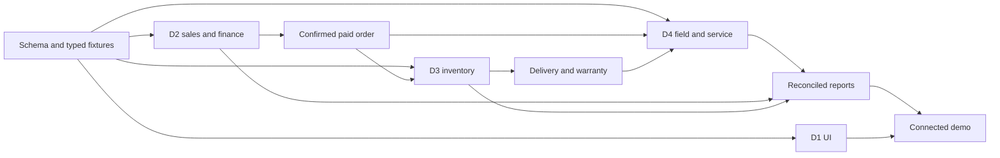

# Relative 24-hour execution plan

The user asked to ignore unverified wall-clock deadlines. These are elapsed-hour budgets, not 24 uninterrupted hours of effort per person. Plan 16–18 focused hours each, stagger breaks, and keep the last two hours as recovery/submission buffer.

## Four-lane timeline

| Hours | D1 frontend | D2 platform/sales/finance | D3 inventory/database | D4 field/service/reports | Gate |
|---|---|---|---|---|---|
| 0–1 | Tokens/shell/page patterns | Runtime/auth/contracts | Joint schema/catalogue | Job/ticket/report contracts | Rules/ownership freeze |
| 1–3 | Forms and mobile scan/signature prototype | Auth/intake/validation | Migrations/stock fixtures | Job/time/evidence fixtures | Persisted authenticated enquiry |
| 3–6 | Sales/survey screens | Approval/quote/order | Receipts/serials/balances | Assignment/completion rules | Approved survey creates quote |
| 6–8 | Quote/BOM/payment UI | Invoice/receipt/subsidy | Atomic allocation | Coverage and ticket API | Paid order ready |
| 8–12 | Warehouse/scan/dispatch | Files/security/build/test harness | Dispatch/delivery/coverage activation | Field completion/time costs | Delivered serial traced |
| 12–16 | Field/service/reports UI | Finance integration/E2E | Replacement primitives/concurrency | Tickets/reports/pay/CSV | Whole lifecycle |
| 16–18 | Mobile/errors/polish | Security/retries | Cost/stock reconciliation | Acceptance walkthrough | Feature freeze |
| 18–20 | Critical UI fixes | Clean startup/release rehearsal | Backup/restore/schema replay | Demo data/reconciliation | Fresh-start rehearsal |
| 20–21 | Visual consistency | Release candidate/README | ERD/test evidence | Timed demo | Release freeze |
| 21–22 | Rehearsal | Artifact/repository verification | Migrations/seed verification | Whole-team presentation | Package ready |
| 22–24 | Recovery | Recovery/submission | Recovery | Recovery/submission | Buffer |

## Contracts and integration

H0.75 initial rules agreed; H1.5 schema/contracts/fixtures; H3 first persisted UI; H8 sales/payment stable; H12 fulfillment stable; H16 entire lifecycle. At each checkpoint D1 gets sequential D2/D3/D4 integration slots, with that owner available to fix issues.

## P0: all mandatory scenes, at simple depth

- Capture enquiry, qualification, follow-up and approved roof survey.
- Generate quote and frozen complete BOM from seeded templates; confirm order and record advance/full payment.
- Show packing requirements and crew assignment automatically; reserve actual stock atomically.
- Scan required serialized units before dispatch; link each customer and unit; delivery starts warranty once.
- Capture installation time/kW/photos/signature; reject incomplete completion.
- Find inverter/customer/warranty; explained free or chargeable repair/replacement; customer-confirmed closure.
- Real invoiced revenue, actual material/labour/repair costs, period/job result, unpaid balances and unfinished work.
- Subsidy paperwork milestones, technician pay summary and CSV.

P0 implementation depth: one warehouse, manual payment recording, seeded catalogue/templates, printable invoice, staff-recorded customer confirmation. These are real database-backed actions, not static cards.

## P1 after connected P0

Template editing, bulk entry/search refinements, portable handover pack, richer service-scope policy, customer confirmation link and improved reports. Required pay/subsidy/scanning/export are not P1.

## P2 / excluded

Reliable offline sync, service reserves, proactive maintenance are optional. No simulation engine, marketplace, chatbot, live government integration, payment gateway, multi-warehouse optimization, full payroll, Redis or distributed workflow infrastructure.

## Scope cuts

- H3 foundation failing: fix auth/API/DB integration before expanding modules.
- H8 behind: remove catalogue/template editors, retain complete seeded templates.
- H12 camera failing: use tested USB scanner; typed serial entry is a disclosed fallback, not proof of scanning.
- H16 missing link: stop optional work and connect the mandatory lifecycle.
- H18 no new features/schema expansion. H21 fixes only for crashes, corruption, access failures or demo blockers.
- Simplify presentation/integration first. Never fake totals, payments, stock allocation, warranty decisions or completion evidence.

## Ten risks

| Risk | Probability / impact | Warning | Prevention / recovery | Owner |
|---|---|---|---|---|
| Sole frontend bottleneck | High/high | Disconnected screens | Six patterns, fixed slots; D2 emergency rescue | D1 |
| D2 overload | High/high | Auth consumes first 3h | Narrow finance APIs; D3 release help | D2 |
| Double allocation | Medium/critical | Unlocked read-check-write | PG concurrency test; stop fulfillment until fixed | D3 |
| Schema drift | High/high | Late shared-field changes | Reviewed migration queue; compatibility changes only | D3 |
| Financial double count | Medium/high | Purchases and consumption both costed | Unique sources/reconciliation; remove wrong cards | D2 |
| Phone scan/files fail | Medium/high | No real-device trial | Early test; USB/file-picker fallback | D1 |
| Isolated modules | High/high | Only fixture demos | Integration gates; pause optional work | D2 |
| Release failure | Medium/high | Cloud-only runnable build | Local release and second-machine backup | D2 |
| Warranty/replacement error | Medium/high | Serial overwritten or expiry reset | Lineage/policy/date tests; reviewed policy | D4 |
| Submission/team omission | Medium/high | Portal unchecked or one member speaks | Verify artifacts, all-member commits/demo | D4 |

## Planning self-critique

Judgment scores, not predictions: feasibility 7/10, workload balance 7, architecture 8, integration 8, PDF coverage 9, UI 7, demo 9, CRUD differentiation 8, deployment 8, competitive strength 8.

Largest weaknesses: D1 UI capacity, D2 platform/finance bottleneck, and breadth of required scope. Mitigations already included: six UI patterns, shared tx helpers owned by each domain, early fixtures/integration, minimal administration, no optional expansion before P0. The research's novelty hypotheses are not validated buyer demand.
