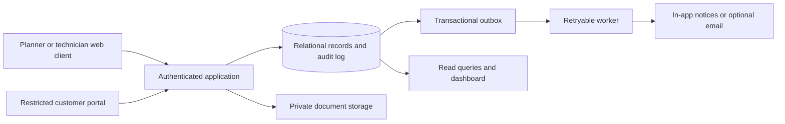

# Independent architecture proposal for both problem statements

Codex · 31 October 2026. Written independently before opening `claude-architecture.md`. Design only; no implementation or technology procurement is authorized.

## Evidence and novelty boundary

This proposal uses the supplied problem PDFs and the competitor findings in `codex-research.md`. It solves the scenario's stated operational problems; it does not turn those problems into verified market-wide gaps. The architecture patterns below are established engineering techniques, newly composed for these two scenarios. They are not claims of a new invention or of capabilities unavailable from competitors.

The research still needs real-user evidence about severity, adoption barriers and willingness to switch. Architecture can show how a mechanism prevents an error, but cannot establish demand or prove why a competitor loses customers. Claude is separately expanding the market evidence.

## Shared approach: one application, explicit ownership, reliable business actions

Use a modular monolith with one relational database and a small background worker. This limits infrastructure work within 24 hours while preserving transaction boundaries. A web client serves desktop and mobile layouts; objects such as photos and signed forms go into private object storage, with metadata and permissions in the database. Any familiar full-stack framework is acceptable. PostgreSQL is one practical option, not a mandated stack.

Modules own their writes. A quote cannot directly edit an asset, a payment screen cannot set profit, and a dashboard cannot alter a transaction. Foreign keys tie the lifecycle together. Every write derives the tenant and user from authenticated context; a customer portal is limited to its assigned customer/job. A role selector in the interface is not authorization.

Use fixed-point monetary amounts with a currency field and documented rounding. Store timestamps in UTC and display local dates. A record may have draft, approved, posted and reversed states as appropriate; do not delete posted money or stock movements. An audit entry records actor, action, entity, timestamp and reason for material changes. This is a normal business audit trail, not a claim of tamper-proof evidence.

Critical synchronous side effects share a database transaction. Delayed notices and exports use an outbox inserted in that same transaction. A worker can retry delivery; uniqueness on `(event_id, handler)` prevents a repeated business effect. Do not promise exactly-once network delivery. Clients send an idempotency key for critical commands; the server stores the result and returns it on retries. Reusing a key with a different request body is rejected.

For the hackathon, run dashboards directly against indexed records or ordinary SQL views. Materialized analytics and event streaming are unnecessary. Use outbox infrastructure only for effects actually delivered asynchronously; a demo with in-app notices can keep task creation in the original transaction.

## A. Solar: an installed-asset history with controlled handoffs

### Mechanisms mapped to pain

| Scenario pain | Architectural mechanism | Observable result | Evidence boundary |
|---|---|---|---|
| Quote issued before survey qualification | Server-enforced survey approval gate; quote captures survey revision | Rejected API command until approval, not only a disabled button | Required by the PDF; competitor-wide absence not established |
| Parts missed when quoting a standard kit | Versioned kit definition expanded into frozen quote/order component lines | Later catalogue edits do not silently change a sold job | Required scenario; ordinary ERP capability |
| Serial lost or assigned twice | Asset registry plus unique active allocation, stock movement ledger and customer association | One serial traces from receipt through dispatch and installation | Competitors already claim related capabilities |
| Warranty dates or free/billed decision disputed | Coverage record per asset with source document, start event and decision explanation | Ticket shows which policy and dates determined the customer charge | Do not hardcode legal scheme rules without current official verification |
| Photos, signature and site work scattered | Completion record referencing job, asset, photos, time and acceptance | Support opens the same installed-system evidence | Required scenario; offline proof and legal validity are separate questions |
| Subsidy steps stall | Assigned milestone with next actor, due date, evidence and blocked reason | Dashboard shows jobs waiting on each party | Checklist is not government submission or approval |
| Margin hides repair costs | Job-linked cost entries, separate receivable/payment records | Covered repair can be free to client while reducing job margin | Accounting definitions must be explicit |

### Data ownership and minimal entities

CRM owns `Lead` and `Customer`; surveying owns immutable approved `SurveyRevision`; sales owns `QuoteRevision`, `Order`, `OrderComponent` and recorded advances. Warehouse owns `Product`, `KitRevision`, `StockMovement`, `Asset`, `AssetAllocation` and `Delivery`. Field service owns `Job`, `Assignment`, `Completion` and evidence references. Support owns `Coverage`, `ServiceTicket`, `CoverageDecision` and `Replacement`. Reporting reads posted invoice/cost entries rather than a manually editable profit number.

`Asset` has an internal UUID, manufacturer, product and serial. Normalize whitespace/case under a documented policy and enforce uniqueness on `(tenant, manufacturer, product, normalized_serial)`; some manufacturers may reuse serial formats across products. Active assignment uniqueness is on the asset ID. Preserve the original scanned string. Do not assume all vendors use globally unique serials.

A panel may also be serialized, since the brief gives panels a long warranty. Model warranty duration and start event as configuration per product/policy. The demo follows the PDF's delivery start. A real deployment must reconcile delivery, commissioning and manufacturer policy rather than silently treating them as equivalent.

### State transitions and transaction boundaries

1. `lead → qualified → survey_scheduled → survey_approved`. Approval identifies the survey revision and actor. Editing approved survey facts makes a new revision. Quote approval checks that its survey revision remains accepted.
2. `quote_draft → sent → accepted`. The quote freezes quantities and prices from a kit revision. Do not let a later kit update rewrite acceptance evidence. Record advance receipt separately; confirmation requires the configured payment gate.
3. Confirm order in one transaction: store confirmation, expand/reserve component requirements, create installation job and assignment placeholder, and emit any notices. Capacity scheduling and reservation are different concepts; the demo must not pretend a placeholder is a confirmed technician booking.
4. Dispatch transaction locks or conditionally updates allocations, checks quantities and serial coverage, posts outbound stock entries, and binds them to delivery/job. Reject duplicate allocation and insufficient stock. A failed transaction posts nothing.
5. Complete delivery once. The first successful completion timestamp starts configured coverage. A retried request returns the same result rather than extending expiry. Cancellation uses a return/reversal operation and does not erase historical delivery.
6. Field completion requires required photos/checklist and customer acceptance evidence. Dispatch/delivery and commissioning remain separate statuses. A customer signature records acceptance with its timestamp; it is not automatically a certified legal-signature service.
7. Open fault ticket against an installed asset. Evaluate component and optional service policy separately. Store the policy revision, relevant dates, demo clock if used, coverage result and reason. Require human review for ambiguous exclusions. Client price and internal repair cost are separate.
8. Replacing an inverter creates a new asset link and closes the old active installation; it does not overwrite the old serial. Warranty continuation versus restart is a policy choice with a source, not an automatic assumption.

### Time and coverage semantics

Define a policy such as `start_date <= assessment_date < expiry_date`. Store explicit expiry date so everyone sees the same boundary; calendar-year arithmetic must specify leap-day handling. Tickets assessed on dates after expiry are not covered by that component policy. A separate service agreement may still cover the customer's bill. Do not present a month-30 subsidized repair as billable until the service obligation is verified. Show the demo time override visibly and store it only in demo data.

### Mobile and offline boundary

Deliver an online responsive form first. Typed serial input works when camera APIs fail; camera scanning requires a supported format and device permission. File uploads have size/type limits, access checks and upload-complete status before evidence is accepted.

If offline work is essential after the MVP, store a local draft with stable command IDs and revision numbers. Display `saved on device`, `syncing`, `synced` and `conflict` distinctly. Queue checklists and photos; do not finalize dispatch, unique asset allocation, billing or warranty adjudication offline. On reconnect, the server validates the current version. Shared-device drafts must be cleared on logout. A successful demo while online does not verify offline reliability.

### Reporting

Show quoted margin, committed margin and actual margin with separate labels. Actual revenue follows a documented posted-invoice policy; customer cash received is different. Cost entries include consumed stock, technician hours at recorded rates, and repair parts/labor. Subsidy expected, approved and received remain separate and are not counted twice as sales revenue. Seed at least one returned/replaced unit and one open repair so lifetime profit is exercised.

### Failure probes

Two technicians attempt to allocate one serial; confirmation is retried after a dropped response; delivery completion repeats the next day; kit changes after quote acceptance; warranty is checked on its exact expiry boundary; replacement must preserve old history; cross-customer document access is rejected; dashboard costs reconcile to posted entries. These probes verify business invariants, not the presence of UI components.

## B. Wedding: a commitment and variation register driving the event

### Mechanisms mapped to pain

| Scenario pain | Architectural mechanism | Observable result | Evidence boundary |
|---|---|---|---|
| Enquiries disappear | One wedding/client record with owned next action and lifecycle state | Unassigned and overdue leads surface in a work queue | PDF scenario, not proof that existing CRMs fail |
| Caterer quotes differ in format and inclusions | Structured comparison schema with original attachment, explicit unknowns and confirmed normalization | Buyer compares like units; missing prices remain unknown, not zero | Alternative RFQs already exist in Odoo |
| Checklist copied manually; deposit action repeated | Versioned package task template and unique wedding-template generation | Booking deposit creates one plan only | Existing project-template pattern |
| Late vendors and schedule changes hidden | Expected/actual arrival plus dependency graph and incident owner | Changes identify affected events without pretending to predict real traffic | Delivery hypothesis requiring venue-user validation |
| Extra plates approved informally | Approved variation links client charge, vendor obligation and invoice line | 60 plates update liability and margin with approval trace | Strong scenario payoff, not established market novelty |
| Advances lost or paid twice | Payable ledger with payment allocations and unique external payment references | Remaining payable is derived consistently | Standard accounting pattern |

### Data ownership and minimal entities

CRM owns `Enquiry`, `Couple`, `Wedding` and `AgreementAcceptance`. Procurement owns `BidRequest`, `BidRevision`, `NormalizedBidLine`, `VendorAward` and `VendorCommitment`. Planning owns `PackageTemplateRevision`, `Task`, `Function`, `RunSheetEntry`, `VendorArrival` and `Incident`. Finance owns `Variation`, `Receivable`, `Payable`, `Payment`, `PaymentAllocation` and cost-rate records.

Every quote line records quantity, unit (`plate`, `hour`, `event`, etc.), included quantity, unit price, overtime/extras, applicable tax representation and exclusions. Unknown tax or inclusion is visibly unresolved. A side-by-side table must not rank a low incomplete quote as equivalent to an all-inclusive one. Original vendor PDFs remain linked, and users confirm normalization; automatic arbitrary-PDF extraction is optional and cannot silently decide commitments.

### State transitions and transaction boundaries

1. Capture enquiry, date range, guest estimate, budget, owner and next action. Agreement acceptance records the document revision and actor. A later agreement change cannot inherit an earlier signature without renewed acceptance.
2. Award one bid in one transaction, guarded by a unique award per request. Bind its frozen revision to the wedding and close losing requests while preserving them as history. Reopening an award requires an explicit change action and reason.
3. Record booking receipt, allocate it to the wedding receivable, and instantiate the correct package task template once. Enforce uniqueness on `(wedding, generation_purpose)` so retry or a second partial deposit cannot create another full plan. Stage future payments according to the agreement; balance and cash are computed separately.
4. Assign vendor arrivals to a function and expected time. Late status is a deterministic time comparison with tolerance, not an AI inference. An incident records owner and proposed schedule changes. Downstream warnings follow explicit dependencies; a planner approves changed times rather than the software moving ceremonies silently.
5. Variation goes `draft → requested → approved/rejected → invoiced`. Approval freezes additional quantity, vendor unit cost, client unit charge, approver and reason. The 60-plate case creates linked obligation and receivable changes atomically; repeating approval cannot add the amount twice. Vendor quote pricing alone is not authority to bill a client for an unapproved extra.
6. Final bill matches the vendor commitment plus approved variations, less allocated advances. Duplicate bill numbers are checked per vendor. Payment references are unique where an external reference exists; near-duplicate invoices still need human review. An unmatched bill enters an exception queue rather than being auto-paid.

### Live event and conflict handling

Poll or server-push run-sheet updates from the same server records. Include a monotonically increasing revision so an older client cannot silently overwrite a more recent plan. For this event size, polling is sufficient; a collaborative CRDT editor is unnecessary.

Use online mobile check-in first. Later, offline vendor-arrival observations can sync as timestamped observations, preserving device time and server-received time. Conflicting observations require reconciliation. Offline client approval of payable changes must not be treated as final until the server validates identity, revision and approval authority. A last-known schedule needs a visible freshness indicator.

### Reporting

For each wedding show agreed client revenue, approved additional charges, vendor commitments, vendor actual bills, internal time cost, remaining receivables and remaining payables. Keep estimated, committed and actual profit distinct. A booking deposit improves cash without creating extra sales revenue. Report portfolio values by wedding/function and give an export with the same inclusion rules as the screen.

### Failure probes

Two users award different caterers simultaneously; repeated receipt creates no duplicate plan; rejected variation changes no payable; 60 extra plates update charge and cost once; vendor advance is deducted once; reversed payment reopens the balance without removing history; stale event update is rejected; a couple cannot retrieve another wedding's bids or private margin.

## 24-hour cut and later evolution

For either problem, prefer six connected scenarios with persistent data over broad disconnected screens. Build authentication and tenant scoping, core relational records, a seeded case and critical transactions first. Use manual recording of real-world payments and uploads rather than untested integrations. Outbox, document extraction, camera scanning and offline sync must not displace the required scenario.

Later, add adapters for messaging, payment providers, accounting or government exports behind owned module APIs. External status needs provider ID, received timestamp and reconciliation state. A webhook is authenticated, deduplicated and checked against current state. Do not split into microservices until separate scaling, ownership or regulatory requirements justify the operational overhead.

If building on Odoo is mandatory, translate these domain rules into supported models, constraints, actions and extensions of its CRM, Sales, Purchase, Inventory, Project, Field Service and accounting apps. Review the actual version and edition before claiming a feature is available. This design does not imply a separate platform is permitted by the event.

## Questions only the owner or field validation can resolve

Which problem is selected; required stack and allowed code reuse; team availability; actual rubric; acceptable legal/payment integration scope; current verified scheme documents; and customer tolerance for connectivity/migration effort. Do not infer these from our preferred architecture.

To validate market usefulness, interview at least a few independent agencies/installers and ask for a recent failed handoff, redacted records, time/cost impact, current tools and the reason they were insufficient. Observe the current workflow where possible. Test a prototype on the actual exception, measure whether the information and ownership remain correct, and ask what would block switching. These are proposed validation steps, not research already conducted.
