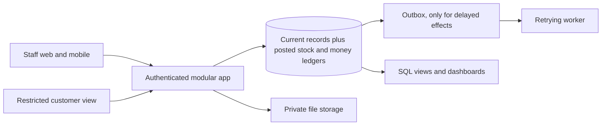

# Merged architecture: Solar and Wedding

Merged by Claude from `codex-architecture.md` and `claude-architecture.md`, with both critiques applied. Cross-review completed by Codex. Design only: nothing is built, tested or approved for implementation.

**What this is:** established engineering patterns applied to these two scenarios. It isn't an invention, and we can't see competitors' internals. Benefits remain hypotheses until tested with users.

## Shared design



| Decision | Choice | Why |
|---|---|---|
| Shape | One modular app and one relational database | Limits deployment and cross-service consistency work in 24h |
| Stack | Team's known NestJS, Prisma, Postgres and React, unless Odoo is mandatory | Switching stacks costs time |
| Records | Normal current rows, plus append-only posted stock and money. **Not full event sourcing.** | Replaying everything adds work without helping the demo |
| Corrections | Reversal entries. Posted stock and money are never edited or deleted. | Keeps history |
| Retries | Idempotency key on critical commands. Same key with a different body is rejected. | A double tap can't apply twice |
| Rule checks | Enforced on the server, inside the transaction that makes the change | A disabled button isn't a rule |
| Access | Tenant and user come from authentication. Every request and download is checked. | A role picker isn't authorisation |
| Money | Fixed-point amounts with currency, and documented rounding | Avoids float errors |
| Time | UTC stored, local shown, injected clock with a visible demo override | Shows "18 months later" honestly |
| Dashboards | Plain SQL views | Enough at this scale |
| Delayed effects | Outbox with a retrying worker, only where something really is delayed | Don't build what the demo doesn't use |
| Mobile | **Online first,** with local drafts. Reliable offline sync is a stretch. | Not required by the PDFs |
| Offline limits | Dispatch, allocation, payment and coverage decisions are never finalised on a device. Pending and server-confirmed are shown separately. | These need server rules |
| Live updates | Polling or server push, with revision numbers to reject stale changes | No need for CRDTs |

**If Odoo is mandatory:** translate these rules into supported extensions of its CRM, Sales, Purchase, Inventory, Project, Field Service and accounting apps, then re-plan. Check the version and edition before relying on a feature.

## A. Solar: installed-asset history with controlled handoffs

### Pain to mechanism

| Pain | Source | Mechanism | Limit |
|---|---|---|---|
| Quote sent before survey | PDF | Server gate; quote records the survey revision | Common in ERPs |
| Parts forgotten | PDF | Versioned kit frozen into order lines | Common in ERPs |
| Serial lost or reused | PDF | Asset registry with one active assignment | SolarBuddy and others claim this |
| Who pays, and why? | PDF, CEEW, KPMG | Coverage decision saved with policy, dates and reason | Doesn't supply technicians |
| Unclear service scope | CEEW | Service scope stored as data | Scope itself is a business decision |
| Subsidy stalls, vendor blamed | World Bank/CAG, Mongabay | Next-owner milestones with evidence | Shows delays, can't force a DISCOM to act |
| Records don't stay with the customer | SunPower cases, KPMG | Exported handover pack | Doesn't guarantee repairs |
| Repairs hide in margins | PDF | Repair cost on the original job | Definitions must be explicit |

### Data ownership

| Module | Owns |
|---|---|
| CRM | Lead, Customer |
| Survey | SurveyRevision (approved revisions are immutable) |
| Sales | QuoteRevision, Order, OrderComponent, recorded advances |
| Warehouse | Product, KitRevision, StockMovement, Asset, AssetAssignment, Delivery |
| Field | Job, Assignment, Completion, evidence references |
| Support | CoveragePolicy, Coverage, ServiceTicket, CoverageDecision, Replacement |
| Subsidy | Milestone with next actor, due date, evidence and blocked reason |
| Finance | Invoice, Payment, MoneyEntry |

### Assets and serials

- **Identity:** each asset has a UUID. Uniqueness is on `(tenant, manufacturer, product, normalized_serial)`, and the scanned original is kept. Serials aren't assumed globally unique.
- **One active assignment:** it lasts through allocation, dispatch, delivery and installation until an explicit return or replacement. This is updated in the same transaction as the stock change, so a delivered unit can't be allocated again.
- **Replacement:** a new asset links to the old one and closes its assignment. The old serial is never overwritten. Whether a warranty continues or restarts is a policy choice.
- **Panels** are serialised, because the PDF gives them a 20-year clock.

### Transitions

1. `lead → qualified → survey_scheduled → survey_approved`. Editing approved facts makes a new revision.
2. `quote_draft → sent → accepted`. The quote freezes prices and quantities from a kit revision.
3. **Confirm order, in one transaction:** record it, expand and reserve parts, and create the job and an assignment placeholder. A placeholder isn't a confirmed technician booking.
4. **Dispatch, in one transaction:** check quantities and serials, post stock, bind to the delivery. Any failure posts nothing.
5. **Complete delivery once.** The first success starts coverage, and a retry returns the same result without extending it.
6. **Field completion** needs the checklist, photos and customer acceptance. Delivery and commissioning remain separate statuses.
7. **Ticket:** evaluate coverage, save the decision, and leave ambiguous exclusions for human review.

### Coverage decision

```
decide(asset, ticket, as_of, policy_revision) ->
  component_covered, service_covered, in_scope, customer_charge,
  internal_cost, supplier_claim_status, reason, dates_used
```

- **Boundary:** `start_date <= assessment_date < expiry_date`, with the expiry date stored explicitly.
- **Separate questions:** customer charge, internal cost and supplier claim. Warranty doesn't guarantee supplier reimbursement.
- **Service scope is data:** CEEW found the 5-year maintenance scope varies and cleaning is usually excluded, so a ticket can answer "not in scope".
- **Policies are configurable.** Don't show a month-30 subsidised repair as billable unless service cover is off in that demo case and the screen says so.
- **Bills and faults:** ticket type suggests routing and staff record the assessment. A high bill can coexist with a fault, so the system never declares "not a fault" by itself.

### Money

```
money_entry: job_id, kind, amount, occurred_at, source_id, reverses_id
kinds: invoice_revenue, customer_receipt, customer_refund,
       material_cost, labour_cost, repair_cost,
       supplier_payment, supplier_recovery, labour_payment, other_job_payment,
       subsidy_expected, subsidy_approved, subsidy_received
```

- **Actual profit** = posted invoices, including repair invoices once + supplier recoveries − material − labour − repair cost.
- **Job cash movement** = customer receipts + cash recoveries − refunds − supplier, labour and other job payments. Show subsidy cash receipts separately and include them only when actually paid to this business; a customer's subsidy is not automatically installer cash. Any recoveries used in profit must follow an explicit recognition policy rather than being counted again on cash receipt.
- **Subsidy** stays separate and is never counted twice as revenue.
- **Stages:** quoted, committed and actual margin, each labelled.
- **Stretch:** a configurable per-job service reserve, labelled as an estimate. CEEW found vendors build free maintenance into the install price, so profit at handover can look too high.

### Handover pack

An exported, self-contained PDF or JSON with serials, dates, service scope, photos and acceptance details. Any QR code holds only a minimal, non-sensitive summary or identifier, with no address or public download token. It doesn't guarantee repairs. Signature hashing alone doesn't establish identity, so call it acceptance evidence.

### Failure probes

Two technicians allocate one serial. Confirmation retried after a dropped response. Delivery completed again next day. Kit changed after quote acceptance. Warranty checked on its expiry date and the day before. Replacement preserves history. A delivered serial can't be reallocated. One customer can't open another's documents. Dashboard totals match posted entries.

## B. Wedding: commitment and variation register driving the event

### Pain to mechanism

| Pain | Source | Mechanism | Limit |
|---|---|---|---|
| Enquiries disappear | PDF | One record with an owner and next action | Not proof CRMs fail |
| Quotes aren't comparable | PDF | Structured quotes as cost formulas, original kept | Odoo already compares RFQs |
| Checklists recopied | PDF | Versioned template, generated once | Common pattern |
| Late vendors spotted late | PDF | Expected vs actual, dependencies, incident owner | Needs venue-user testing |
| Extras approved informally | PDF | Variation linking client charge and vendor obligation | Scenario payoff, not proven novelty |
| Advances lost or paid twice | PDF | Payables with allocations and unique references | Standard accounting |
| Couple paid, vendor unpaid | Singapore and US news | Optional pass-through payment status for couples | Contract decides what they see |

### Data ownership

| Module | Owns |
|---|---|
| CRM | Enquiry, Couple, Wedding, AgreementAcceptance |
| Procurement | BidRequest, BidRevision, BidLine, VendorAward, VendorCommitment |
| Planning | TemplateRevision, Task, Function, RunSheetEntry, VendorArrival, Incident |
| Finance | Variation, Receivable, Payable, Payment, PaymentAllocation, CostRate |

### Quotes

Lines record unit, included quantity, unit price, overtime and exclusions. **Unknown prices stay visibly unresolved,** so an incomplete quote can't rank as cheapest. A person confirms the entered lines, and the original PDF stays attached. Automatic PDF extraction is optional and never decides a commitment.

```
total(guests, extra_hours) =
    fixed + per_plate × max(guests, minimum_guests)
          + hourly_rate × extra_hours + sum(required extras)
```

This compares caterers at 400 **and** at 460 guests, which links the quote scene to the 60-extra-guests scene.

### Transitions

1. **Agreement acceptance** records the document revision and actor. A changed agreement needs fresh acceptance.
2. **Award, in one transaction:** a unique award per request, frozen revision bound to the wedding, losing requests closed but kept. Reopening needs a reason.
3. **First qualifying booking receipt creates the plan once,** keyed on `(tenant, wedding, generation_purpose)`, recording the template revision. Receipt retries and plan generation are protected separately, so a second part-payment can't create a second plan.
4. **Lateness** is a plain time comparison with a tolerance. Dependencies warn about affected events and a planner approves any change. Software never moves a ceremony.
5. **Variation:** `draft → requested → approved or rejected → invoiced`. Approval freezes quantity, vendor cost, client charge, approver and reason, and updates both sides atomically. Repeating approval adds nothing.
6. **Final bill** matches commitment plus approved variations, less allocated advances. Duplicate bill numbers per vendor are blocked, and unmatched bills go to a review queue rather than being auto-paid.

### Reporting and access

- **Margin stages:** estimated, committed and actual, each labelled. A deposit improves cash and isn't extra revenue.
- **Portfolio:** per wedding and per function, with an export using the same rules as the screen.
- **Couples** see only their own wedding, and only what the agency's contract allows. **Vendor cost and agency margin are hidden by default.**

### Failure probes

Two users award different caterers at once. A second part-payment creates no second plan. A rejected variation changes nothing. 60 extra plates change charge and cost once. An advance is deducted once. A reversed payment reopens the balance while keeping history. A stale run-sheet update is rejected. A couple can't read another wedding's bids or margin.

## 24-hour cut

**First, for either problem:** auth and scoping, core records, one seeded case and the critical transactions, connected across all six scenes.

| | Must | Should | Stretch |
|---|---|---|---|
| **Solar** | Survey gate, kits, stock and assets, typed serial entry, online phone form with photos and signature, coverage decision, tickets, job money, CSV export | Camera scanning, handover pack, subsidy milestones | Offline sync, service reserve |
| **Wedding** | Enquiry and agreement, quotes and award, plan generation, run-sheet with lateness, variations, bills, payments, margins, CSV export | Cost-formula comparison, dependency warnings, couple status view | Offline check-ins, PDF extraction |

Record real-world payments manually, with no live payment integration.

## What this doesn't solve

- **Adoption:** we have no user evidence about whether staff would use it.
- **Outside systems:** no government, supplier or utility integration. Status depends on someone entering it.
- **Missing capacity:** software can't supply technicians or speed up a DISCOM.
- **Legal strength of signatures:** not checked against Indian e-signature law.
- **Validation:** to test usefulness, interview a few independent agencies and installers about a recent failed handoff, its cost and why their current tools fell short. This has not been done.
